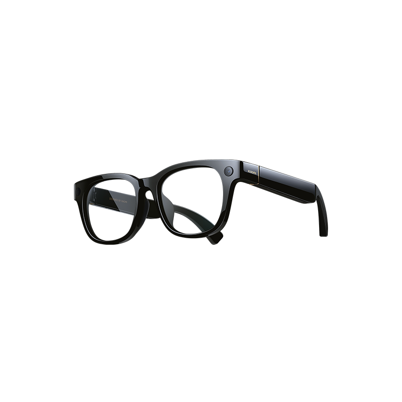
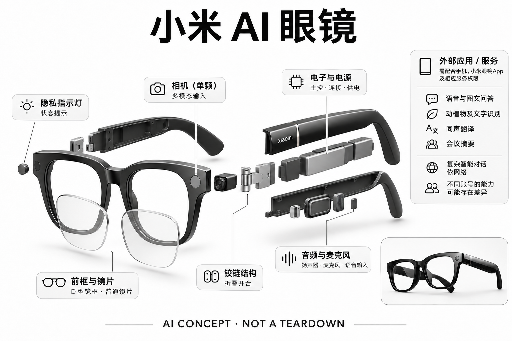

# 小米 AI 眼镜

**Xiaomi** · AI 眼镜 · 核查 2026-11-04

在中国服务生态中使用的相机与超级小爱入口

消费渠道：个人零售。

## 产品图片与结构参考

### 产品图

小米 AI 眼镜官方产品外形图 · 来源：[Xiaomi · 官方产品图片](<https://www.mi.com/shop/buy/detail?product_id=21399>) · [原始图片](<https://cdn.cnbj0.fds.api.mi-img.com/b2c-shopapi-pms/pms_1750933700.55656745.png>)

### 参考图

小米 AI 眼镜官方另一角度或使用场景参考 · 来源：[Xiaomi · 官方产品图片](<https://www.mi.com/prod/xiaomi-ai-glasses>) · [原始图片](<https://cdn.cnbj1.fds.api.mi-img.com/product-images/xiaomi-ai-glasses_821009/images/12328.jpg>)

### AI 生成爆炸示意

**AI 生成 · 非实物拆机。** 内部为概念推断，不能作为元件布局、BOM 或维修依据。[生成提示词](../../content/hardware/prompts/xiaomi-ai-glasses.txt)

> 外形依据核验参考图；内部位置、模块形状与装配关系仅作AI概念展示。

> 已逐张查看并核对型号。源图未改色/裁切；场景、界面、附件、优惠及效果文案仅为厂商示意，不作为本目录性能或现价依据。

> 分析为基于公开资料的案头研究与 AI 辅助判断，未经用户访谈、销量审计或实物拆机。需求、画像、竞争冷门度、审美及商业机会均为研究假设，不是投资结论。

## 销售与购买

- 状态：在售。实际浏览器打开小米商城product_id=21399，标准版页面显示小米自营、有现货、¥1,599与加入购物车；具体颜色及收货地区库存仍随订单变化。

- 地区：中国大陆官方渠道

- 价格：标准版核查日 ¥1,599 起。核查日所见单机或基本配置价；币种、促销、税费、镜片、附件及服务依地区结算，不把颜色或套装重复计数。

- 中国大陆：已在小米商城打开具体型号，页面显示自营、现货和加入购物车；未登录或下单。

- [官方产品 / 商店](<https://www.mi.com/prod/xiaomi-ai-glasses>)

## AI 的实际作用

官方详情已确认：超级小爱提供语音与图文问答、动植物及文字识别、同声翻译和会议摘要；相机与语音输入共同构成多模态入口。

服务与联网依赖：需要兼容手机、小米眼镜App及相应服务权限，复杂智能对话依网络；不默认中国与海外账号拥有相同能力

## 是否冷门

新兴竞争（研究判断）：按任务与形态作案头分类，无访谈、销量或市场份额证据。

## 需求与市场

需求假设：希望把随手拍摄和即时语音查询放到眼镜上，并使用熟悉的中国本地服务。价值应由实际使用频率、任务完成与操作负担验证，不能把AI功能存在或演示流畅当作需求已得到满足。

## 用户画像

画像推断：已有小米或兼容手机，愿意在日常场合佩戴相机眼镜并管理记录的人。个人的语言、操作习惯、环境和预算会改变适配结果，本次只有案头研究，没有用户访谈或长期使用观察。

## 竞争与替代

案头判断：与国内AI相机眼镜和Meta同类产品竞争，中文服务及本地售后是差异而非冷门蓝海。这只是用途与替代品比较，不是市场份额或销量结论；专业细分和较少曝光也不代表没有成熟竞争者。

## 供应链

公开资料可核对D形镜框、单前向相机、镜腿麦克风/开放式音频和物理控制，具体整机工厂、关键模块供应商与BOM本次未确认。制造重点可从形态推断，但不能把品牌所在地、外观相似或营销合作等同代工关系。

## 技术路径

通过超级小爱完成语音识别、自然语言智能对话和语音控制；相机提供第一人称采集，视觉问答等功能需按当前软件版本确认。这是厂商披露的功能机制；模型版本、准确率及内部结构未完整公开。架构只表示输入、处理和输出关系，不作为真实拆机或性能实测。

## 产品审美

图示观察：经典D形较像普通太阳镜，镜腿需要容纳电子件；标准与变色镜片是配置差异。宣传图片只能帮助理解外观和摆放方式，不能证明每个人的舒适度、长时使用体验或实际材料触感。

## 关键风险

拍摄提示、旁人知情、服务权限和户外分心均需考虑；镜片处方和变色选项不是独立AI型号，配镜后的退货条件不同。还需核对地区功能、软件更新与售后边界；本目录未进行实机、医学或可靠性测试，不把厂商演示当作结果保证。

## 机会与验证

市场差异主要在于在中国服务生态中使用的相机与超级小爱入口。值得进一步验证的购买理由是它能否减少既有任务中的具体步骤，以及硬件、服务与维护的总成本是否符合个人使用频率。

## 功能分层示意

这是功能关系，不是实物拆机、真实空间结构或已核实 BOM。

1. **实体输入**：D形镜框、单前向相机、镜腿麦克风/开放式音频和物理控制；仅功能层示意，非拆机。（官方披露）

2. **采集与控制**：设备把输入转为可处理的信息并接收用户操作；具体内部布局未知。（分析推断）

3. **AI功能**：通过超级小爱完成语音识别、自然语言智能对话和语音控制；相机提供第一人称采集，视觉问答等功能需按当前软件版本确认（官方披露）

4. **服务依赖**：需要兼容手机、小米眼镜App及相应服务权限，复杂智能对话依网络；不默认中国与海外账号拥有相同能力（官方披露）

5. **用户反馈**：用户通过声音、屏幕或配套应用接收结果，并对重要信息复核。（分析推断）

## 来源

1. [小米AI眼镜官方详情](<https://www.mi.com/prod/xiaomi-ai-glasses>) — 已打开一手页面；产品能力为厂商披露，未进行实机或效果验证。

2. [小米AI眼镜官方实际购买页](<https://www.mi.com/shop/buy/detail?product_id=21399>) — 已用浏览器查看加载后的具体产品，现货及加入购物车可见；未登录和下单。

3. [超级小爱第三方数据共享说明](<https://privacy.mi.com/xiaomihyperxiaoai-s/zh_CN/>) — 已用浏览器打开，XiaoAiWear SDK条目明确小米眼镜的语音识别、合成和智能对话。

[返回目录](../hardware-market.md) · [网页分析](https://romanagent.github.io/Roman/#hardware/product/xiaomi-ai-glasses)
