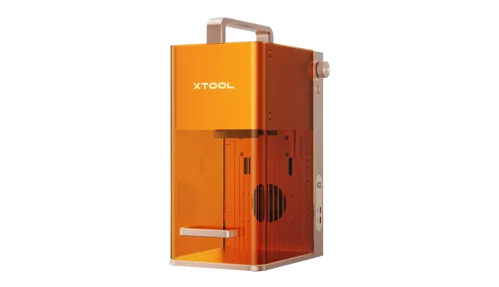
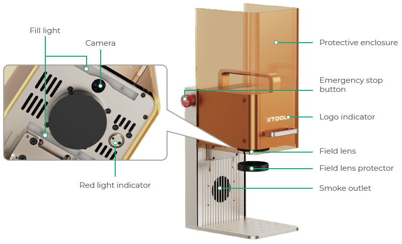
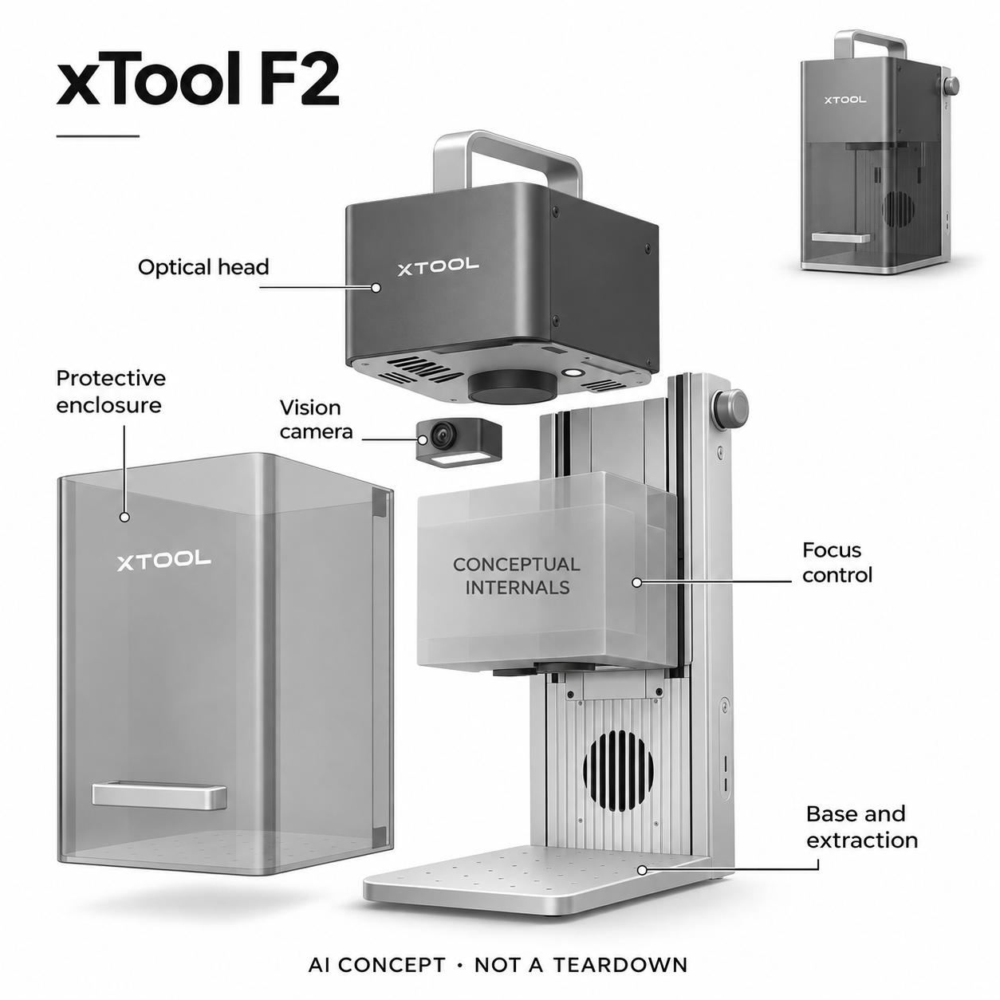

# xTool F2

**xTool** · 专业兴趣工具 · 核查 2026-11-04

用AI视觉辨认工件并辅助批量定位的便携雕刻机

消费渠道：个人零售。

## 产品图片与结构参考

### 产品图

xTool F2 官方产品图 · 来源：[xTool · 官方资料](<https://uk.xtool.com/products/xtool-f2-5w-ir-15w-diode-portable-dual-laser-engraver>) · [原始图片](<https://cdn.shopify.com/s/files/1/0467/7985/9095/files/mk-guanwang_us_pc_f2_1219-5500.webp?v=1778491125>)

### 官方结构参考

xTool F2 官方外部结构与摄像头位置图（厂商资料） · 来源：[xTool · 官方资料](<https://support.xtool.com/article/2013?from=xTool+F2&url=/product/60>) · [原始图片](<https://storage-us.atomm.com/resource/xtool/xcs-cms/community/activity/0ac9e08e-232f-443a-b865-70540dd39148_38320fed-7743-45bb-b4b1-28838ea08c71_image.octet-stream>)

### AI 生成爆炸示意

**AI 生成 · 非实物拆机。** 内部为概念推断，不能作为元件布局、BOM 或维修依据。[生成提示词](../../content/hardware/prompts/xtool-f2.txt)

> 以已目视核对的官方图片独立生成，未知内部为功能概念，不代表真实PCB、拆机或已采用供应商。

> 保留官方图片原貌；图片中的宣传数字和效果不作为本站实测。

> 分析为基于公开资料的案头研究与 AI 辅助判断，未经用户访谈、销量审计或实物拆机。需求、画像、竞争冷门度、审美及商业机会均为研究假设，不是投资结论。

## 销售与购买

- 状态：在售。核查日英国官网浏览器实际显示F2 Standalone、启用的Add to Bag、1–3个工作日发货；主机促销显示£1,039。页面抓取混有隐藏Sold Out文案，已用当前UI核对。仅收F2，不另计同需求F1/Ultra。

- 地区：英国（本轮实际核查商店）

- 价格：英国官网主机显示£1,039促销价。浏览器实际选定F2 Standalone，页面有自动优惠；最终税价按目的地结算，参考原价£1,299。配件和防护排烟配置另核。

- 中国大陆：本轮核到英国官方零售；F2中国大陆官方库存、版本及跨境保修未独立确认，不由品牌背景推断国内可买。

- [官方产品 / 商店](<https://uk.xtool.com/products/xtool-f2-5w-ir-15w-diode-portable-dual-laser-engraver>)

## AI 的实际作用

官方FAQ明确批处理依赖AI摄像识别工件轮廓；Studio 1.9另明确F2支持图像材料识别和加工试样阵列分析，辅助定位与参数选择。

服务与联网依赖：视觉与参数工作流依赖xTool Studio及兼容固件，不把AI图案生成当唯一依据。识别要求清晰轮廓与足够背景对比；安全操作、材料适配和排烟仍需人工确认。

## 是否冷门

细分专业（研究判断）：桌面加工属于明确创作工具，已有成熟激光、外包和夹具方案；定位创新需要在真实材料上验证。

## 需求与市场

案头需求是让个人创作者在小物件上做定制标记，减少逐件定位和重复试参数的时间。AI进入工件识别与加工准备，但并不会自动完成安全选材或替用户确认设计尺寸，实际收益要看废料和调试时间。

### 事实：任务边界 · 官方资料

F2的官方FAQ明确把批处理工件识别列为AI摄像工作流，适合个人创作者对小型实物做定制标记。机器需要由人放料、确认图案和加工条件；AI作用在减少重复定位和参数选择工作，而不是把任意设计自动变成无需检查的合格成品。

依据：[xTool F2英国官方商店](<https://uk.xtool.com/products/xtool-f2-5w-ir-15w-diode-portable-dual-laser-engraver>) · [xTool F2官方FAQ](<https://support.xtool.com/article/2818>)

### 判断：真实需求 · 研究判断

需求判断应聚焦手作人的准备成本：少量但经常变化的钥匙扣、铭牌或礼物可能更需要快速对位；大量完全相同的物件反而可能用固定夹具更稳定。若用户主要烦恼订单来源或设计能力，增加视觉识别不一定解决其最重要的问题。

依据：[xTool F2英国官方商店](<https://uk.xtool.com/products/xtool-f2-5w-ir-15w-diode-portable-dual-laser-engraver>) · [xTool F2官方FAQ](<https://support.xtool.com/article/2818>)

### 验证：任务完成 · 待验证

调研可让参与者用自己的常见材料完成小批任务，记录导入、对位、试样与返工分别花多久。访谈问最常报废的原因、哪些步骤必须亲眼复查，以及更愿意买机器还是付费外包；不把一次演示的速度转成月产量或收入估计。

依据：[xTool F2英国官方商店](<https://uk.xtool.com/products/xtool-f2-5w-ir-15w-diode-portable-dual-laser-engraver>) · [xTool F2官方FAQ](<https://support.xtool.com/article/2818>)

## 用户画像

更适合有固定手作空间、愿意学习材料与通风要求的个人工作室和摆摊创作者。购买资格不等于即放即用；普通家庭若无法设置合适加工环境，视觉自动化也无法消除基础操作条件。

### 事实：使用条件 · 官方资料

英国官网面向手作和现场定制提供主机零售，用户指南也列出基础安装、排烟和维护要求。它并非需要企业账号才能购买的大型产线，但个人可购不意味着无门槛；能否提供合适材料、工作区域和操作管理，是比购买预算更早的适配条件。

依据：[xTool F2英国官方商店](<https://uk.xtool.com/products/xtool-f2-5w-ir-15w-diode-portable-dual-laser-engraver>) · [xTool F2用户指南](<https://support.xtool.com/article/2013?from=xTool+F2&url=/product/60>)

### 判断：人群筛选 · 研究判断

适用画像可以区分家中制作礼物的人、固定小工作室和偶尔到活动现场定制的个人经营者。三者面对不同的搬运、排烟与等待需求，不能将品牌页面中的成功商家故事当成本轮样本访谈，也不以有副业想法推断会持续使用激光设备。

依据：[xTool F2英国官方商店](<https://uk.xtool.com/products/xtool-f2-5w-ir-15w-diode-portable-dual-laser-engraver>) · [xTool F2用户指南](<https://support.xtool.com/article/2013?from=xTool+F2&url=/product/60>)

### 验证：参与者差异 · 待验证

招募应先了解参与者现有工作台、通风条件和加工经验，再让其说明所需成品和可接受失败成本。访谈包括是否愿意处理烟尘、多久愿意维护、活动场地是否允许设备运行；不适配者的原因同样保留，避免只研究已经熟悉加工的人。

依据：[xTool F2英国官方商店](<https://uk.xtool.com/products/xtool-f2-5w-ir-15w-diode-portable-dual-laser-engraver>) · [xTool F2用户指南](<https://support.xtool.com/article/2013?from=xTool+F2&url=/product/60>)

## 竞争与替代

替代包括外包刻字、手动定位的小型雕刻机和夹具批处理。目录只保留这一个便携视觉雕刻代表，不将同系列功率升级再计为场景；比较应关注实际小批任务而非宣传加工速度。

### 事实：方案范围 · 官方资料

目录在本轮仅选F2一个便携视觉雕刻代表，没有继续添加F1、F1 Ultra或其它功率版本。官方软件更新把F2列为材料识别及试样分析兼容设备，而未将这些新功能列给F1 Ultra，选定型号后必须按其兼容范围陈述，不能跨型号拼能力。

依据：[xTool F2英国官方商店](<https://uk.xtool.com/products/xtool-f2-5w-ir-15w-diode-portable-dual-laser-engraver>) · [xTool F2官方FAQ](<https://support.xtool.com/article/2818>) · [xTool Studio 1.9发行说明](<https://support.xtool.com/article/3808>)

### 判断：替代关系 · 研究判断

直接替代包括手动定位的小型雕刻设备、专用夹具和外包刻字。视觉自动化能降低逐件对位的可能性，但反光、透明或低对比材料可能让简单夹具更可靠；是否更好应以实际任务的完整流程比较，而不是以带AI字样的功能数量排名。

依据：[xTool F2英国官方商店](<https://uk.xtool.com/products/xtool-f2-5w-ir-15w-diode-portable-dual-laser-engraver>) · [xTool F2官方FAQ](<https://support.xtool.com/article/2818>) · [xTool Studio 1.9发行说明](<https://support.xtool.com/article/3808>)

### 验证：比较方法 · 待验证

可以给不同方案相同物料和图案，分别记录首件设置、第二批复用、合格率与人工纠正次数。对只做一次的礼物也应计算学习投入和收纳成本；如果外包更省心，就保留这一结论，不用宣传最高扫描速度代替用户得到成品的总时间。

依据：[xTool F2英国官方商店](<https://uk.xtool.com/products/xtool-f2-5w-ir-15w-diode-portable-dual-laser-engraver>) · [xTool F2官方FAQ](<https://support.xtool.com/article/2818>) · [xTool Studio 1.9发行说明](<https://support.xtool.com/article/3808>)

## 供应链

功能上需要光源与光路、相机、调焦运动、控制、保护罩和排烟接口。实际上游供应商与工厂未披露；光机标定、热漂移和材料残留会影响一致性，不能用通用相机模组拼成完整方案。

### 事实：功能组成 · 官方资料

已打开的官方结构图显示头部相机、补光、场镜、竖向结构、保护罩和排烟出口，主机采用两种加工光源。品牌没有在这些资料里披露各光源、视觉模组或控制板的供应商，因此本条不猜测具体激光器、芯片和代工厂，也不从外壳图计算BOM。

依据：[xTool F2英国官方商店](<https://uk.xtool.com/products/xtool-f2-5w-ir-15w-diode-portable-dual-laser-engraver>) · [xTool F2用户指南](<https://support.xtool.com/article/2013?from=xTool+F2&url=/product/60>)

### 判断：交付约束 · 研究判断

工程约束在于视觉坐标与真实光束加工位置的标定，温升、搬运和光学污染都可能影响重复结果。安全结构、材料残留、排烟和软件参数又相互牵制；单独采购高像素相机或更高功率光源并不能保证工作台上获得相同定位体验。

依据：[xTool F2英国官方商店](<https://uk.xtool.com/products/xtool-f2-5w-ir-15w-diode-portable-dual-laser-engraver>) · [xTool F2用户指南](<https://support.xtool.com/article/2013?from=xTool+F2&url=/product/60>)

### 验证：选型缺口 · 待验证

e-con Systems可作为视觉模组和集成能力候选，FAULHABER可作为光学调焦运动能力候选。它们都不是已公开采用公司，选型必须确认成像接口、照明条件、运动精度、体积和控制要求；没有整机接口资料时不提供可直接替代的采购清单。

依据：[xTool F2英国官方商店](<https://uk.xtool.com/products/xtool-f2-5w-ir-15w-diode-portable-dual-laser-engraver>) · [xTool F2用户指南](<https://support.xtool.com/article/2013?from=xTool+F2&url=/product/60>)

## 技术路径

官方列出AI摄像识别适合清晰、非反光且与背景有对比的工件；材料照片识别和试样分析是软件功能。新旧官网对第三方软件兼容有冲突，本条以自家Studio为已核工作流，不宣称全软件通用。

### 事实：AI机制 · 官方资料

官方FAQ明确说明批处理依赖AI摄像识别，并列出轮廓清楚、非反光、背景有对比和表面平整等前提。Studio发行说明另外确认F2支持上传材料照片识别以及试样阵列分析；这些是具体感知与决策辅助，和普通自动对焦或生成图案不是同一件事。

依据：[xTool F2官方FAQ](<https://support.xtool.com/article/2818>) · [xTool Studio 1.9发行说明](<https://support.xtool.com/article/3808>)

### 判断：系统边界 · 研究判断

模型结果需要由使用者确认，因为近似材质在照片中可能难以区分，表面外观也不能完整代表加工风险。官方未披露这些模型的训练集和逐材料准确率，本条不把软件推荐解释为安全认证，也不声称全部计算都在雕刻机的控制板上完成。

依据：[xTool F2官方FAQ](<https://support.xtool.com/article/2818>) · [xTool Studio 1.9发行说明](<https://support.xtool.com/article/3808>)

### 验证：算法与体验 · 待验证

可用相似外观但实际不同的合规材料、不同摆放角度和背景测试识别，检查系统是否提示不确定以及用户能否改选。试样分析要与人工观察对照，保留无法识别的格子；测试重点是减少试错是否可重复，而不是只挑一次成功的识别画面。

依据：[xTool F2官方FAQ](<https://support.xtool.com/article/2818>) · [xTool Studio 1.9发行说明](<https://support.xtool.com/article/3808>)

## 产品审美

提手、竖向滑动罩和小底座形成便携机台形态，透明罩让加工区域可见。审美需要同时考虑桌面线缆、排烟管和装卸物件，单机小巧并不意味着整个安全工作区同样小。

### 事实：外观与交互 · 官方资料

F2实物采用顶部提手、竖向滑动保护罩和小底座，官方结构图能看到头部相机及排烟位置。标准包装不含外接触屏控制器、旋转附件和滑台，因此概念图只展示主机基础结构，并把未披露内部画成抽象模块，避免把豪华套装误当标配。

依据：[xTool F2英国官方商店](<https://uk.xtool.com/products/xtool-f2-5w-ir-15w-diode-portable-dual-laser-engraver>) · [xTool F2用户指南](<https://support.xtool.com/article/2013?from=xTool+F2&url=/product/60>)

### 判断：使用中的形态 · 研究判断

外形便携不等于完整加工系统只占主机那么大的空间。排烟管、电脑、物料、上下料动作和保护区域都会扩展使用范围；透明罩便于看见物件，也可能让初学者误以为看得见就可以靠近，审美评估应检查这种视觉暗示是否清楚。

依据：[xTool F2英国官方商店](<https://uk.xtool.com/products/xtool-f2-5w-ir-15w-diode-portable-dual-laser-engraver>) · [xTool F2用户指南](<https://support.xtool.com/article/2013?from=xTool+F2&url=/product/60>)

### 验证：日常接受度 · 待验证

让用户从运输状态布置到可工作状态，记录提手握持、排烟连接和材料取放时是否有妨碍，并询问哪些部位会被误当成开关。收纳后再装回一次，观察是否保持定位与操作理解，避免把好看的单机图当作适合任何家庭桌面的证据。

依据：[xTool F2英国官方商店](<https://uk.xtool.com/products/xtool-f2-5w-ir-15w-diode-portable-dual-laser-engraver>) · [xTool F2用户指南](<https://support.xtool.com/article/2013?from=xTool+F2&url=/product/60>)

## 关键风险

风险包括反光或透明材料导致识别不稳、错误参数损坏工件，以及把封闭外观误当作不需要防护。标准机不含所有扩展附件，开罩加工和扩展台面的条件必须按厂商安全说明执行。

### 事实：已知限制 · 官方资料

官方指南设置急停、访问钥匙和保护罩，并明确涉及旋转附件或开放加工时的额外操作条件。FAQ列出一些不应加工或不适合批识别的材料；这些边界说明机器的家用可购定位并不消除激光、烟尘、材料和误操作方面的具体限制。

依据：[xTool F2英国官方商店](<https://uk.xtool.com/products/xtool-f2-5w-ir-15w-diode-portable-dual-laser-engraver>) · [xTool F2官方FAQ](<https://support.xtool.com/article/2818>) · [xTool F2用户指南](<https://support.xtool.com/article/2013?from=xTool+F2&url=/product/60>)

### 判断：失效影响 · 研究判断

信息风险还包括官网不同页面对LightBurn兼容的表述不一致，以及促销价随活动、税费和目的地变化。本条以实际核实的Studio工作流和主机配置为准，未把第三方软件兼容当确定能力，也不将自动优惠后的展示价当作所有地区固定成交价。

依据：[xTool F2英国官方商店](<https://uk.xtool.com/products/xtool-f2-5w-ir-15w-diode-portable-dual-laser-engraver>) · [xTool F2官方FAQ](<https://support.xtool.com/article/2818>) · [xTool F2用户指南](<https://support.xtool.com/article/2013?from=xTool+F2&url=/product/60>)

### 验证：风险处理 · 待验证

验证应从厂商允许的材料与闭合使用条件开始，检查识别失败后是否容易发现并停止，记录急停和正常关机是否被混淆。采购前核对目标地区版本、排烟防护和配件清单，并向品牌确认所需软件版本，不能让AI建议代替这些基础确认。

依据：[xTool F2英国官方商店](<https://uk.xtool.com/products/xtool-f2-5w-ir-15w-diode-portable-dual-laser-engraver>) · [xTool F2官方FAQ](<https://support.xtool.com/article/2818>) · [xTool F2用户指南](<https://support.xtool.com/article/2013?from=xTool+F2&url=/product/60>)

## 机会与验证

可验证机会在小批定制准备环节：记录新用户从图案到合格成品的试样次数、错位率和耗材损失。若人工夹具更可靠，就保留这一反例，不能因AI识别标签判断一定提高个人创作者收益。

### 判断：可尝试切口 · 研究判断

可尝试的机会是帮助个人创作者建立自己的材料试样和重复任务档案，把视觉识别结果与实际成品反馈连接起来。若相同工件总要重新调整，保存可靠参数和夹具可能比继续增加生成图案入口更有价值；这个判断尚需用户真实加工记录验证。

依据：[xTool F2英国官方商店](<https://uk.xtool.com/products/xtool-f2-5w-ir-15w-diode-portable-dual-laser-engraver>) · [xTool F2官方FAQ](<https://support.xtool.com/article/2818>) · [xTool Studio 1.9发行说明](<https://support.xtool.com/article/3808>)

### 判断：商业边界 · 研究判断

商业边界在于小批定制的主要成本可能是设计沟通、物料或场地，而不一定是雕刻速度。设备本身便携也不保证活动方允许使用，个人工作室需要的辅料与维护成本不能忽略；本轮没有经营访谈，不能据商店故事预测回本周期。

依据：[xTool F2英国官方商店](<https://uk.xtool.com/products/xtool-f2-5w-ir-15w-diode-portable-dual-laser-engraver>) · [xTool F2官方FAQ](<https://support.xtool.com/article/2818>) · [xTool Studio 1.9发行说明](<https://support.xtool.com/article/3808>)

### 验证：下一步调研 · 待验证

下一步可跟踪几名创作者完成三个不同实际项目，记录首次设置、复用、报废及维护，并问其为何放弃某种材料或场地。将设备使用行为与业务收益分开分析，不用模型给出的创新等级、订单数量假设或最快演示推导市场成功。

依据：[xTool F2英国官方商店](<https://uk.xtool.com/products/xtool-f2-5w-ir-15w-diode-portable-dual-laser-engraver>) · [xTool F2官方FAQ](<https://support.xtool.com/article/2818>) · [xTool Studio 1.9发行说明](<https://support.xtool.com/article/3808>)

## 对应供应链公司

能力候选用于选型研究，不代表本产品实际采用；未公开的供货关系不作推断。

- [e-con-systems](../supply-chain/e-con-systems.md) — **能力候选 · 非已采用** / 工件识别相机集成候选：F2需要相机图像进入工件定位与材料工作流，e-con Systems公开嵌入式视觉相机和定制集成能力，适合作为功能候选。成像接口、标定、照明和加工环境仍须验证，本轮没有其向xTool F2供货的点名资料。

- [faulhaber](../supply-chain/faulhaber.md) — **能力候选 · 非已采用** / 光学头调焦运动能力候选：F2的竖向调焦需要紧凑运动与位置控制，FAULHABER公开光学设备驱动和定制工程能力，可作为此模块的选型候选。其行程、承载、反馈与控制兼容尚未知，不能因为具备精密电机产品就断言已被xTool采用。

[浏览供应链目录](../supply-chain.md)

## 功能分层示意

这是功能关系，不是实物拆机、真实空间结构或已核实 BOM。

1. **工件视觉**：头部摄像头捕获工件，AI识别辅助批量填充与定位。（官方披露）

2. **加工光学**：二极管和红外双光源执行对应材料的雕刻，光路不在概念图中推定。（官方披露）

3. **调焦与结构**：竖向调焦结构、底板及提手支持桌面使用。（官方披露）

4. **软件工作流**：Studio组织设计、材料识别、试样结果分析及设备控制。（官方披露）

5. **保护与排烟**：滑动保护罩、急停、钥匙与排烟接口构成操作边界，不能视作无条件安全。（官方披露）

## 来源

1. [xTool F2英国官方商店](<https://uk.xtool.com/products/xtool-f2-5w-ir-15w-diode-portable-dual-laser-engraver>) — 实际web打开并浏览器核对现售主机、购买按钮、1–3天发货及促销显示；未提交订单。

2. [xTool F2官方FAQ](<https://support.xtool.com/article/2818>) — 实际打开；明确AI摄像识别批处理及工件适配限制。

3. [xTool Studio 1.9发行说明](<https://support.xtool.com/article/3808>) — 实际打开；F2在AI材料识别和试样阵列分析支持名单，不能移植给未列出的F1 Ultra。

4. [xTool F2用户指南](<https://support.xtool.com/article/2013?from=xTool+F2&url=/product/60>) — 实际打开；MXF-K005-002结构图、相机、调焦、急停及配件不包含说明。

[返回目录](../hardware-market.md) · [网页分析](https://romanagent.github.io/Roman/#hardware/product/xtool-f2)
