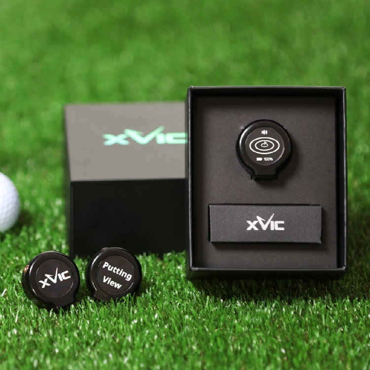
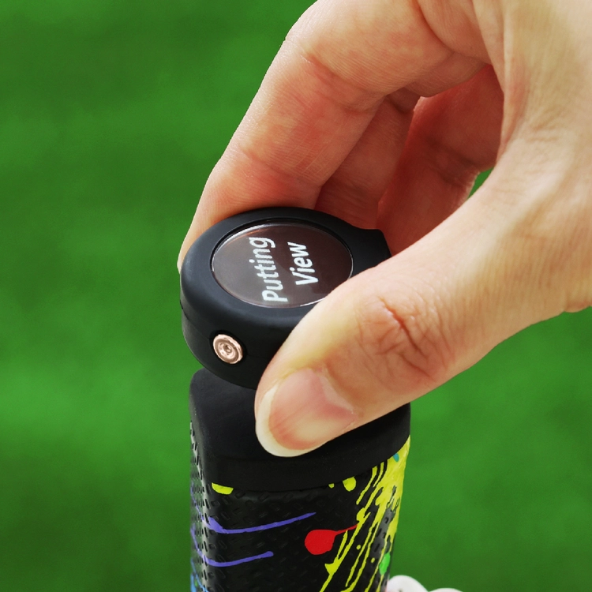
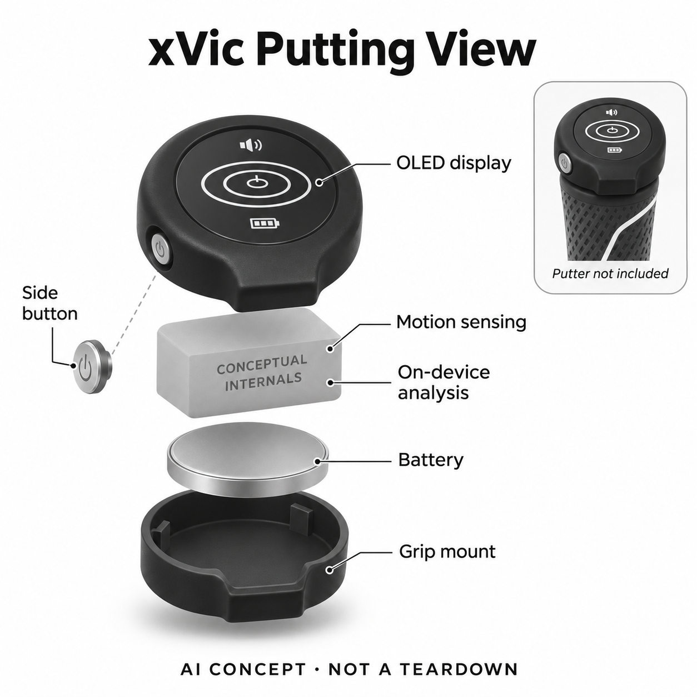

# xVic Putting View

**xVic** · 运动与训练 · 核查 2026-11-05

在推杆握柄末端直接显示动作估计结果的训练传感器

消费渠道：个人零售。

## 产品图片与结构参考

### 产品图

Putting View 官方包装与不同显示状态参考（不表示多台标配） · 来源：[xVic · 官方资料](<https://en.myxvic.com/shop_view/?idx=181>) · [原始图片](<https://cdn-optimized.imweb.me/upload/S20230613de758e6f021ec/b5c9b1ed5ce39.jpg?w=750>)

### 参考图

Putting View 官方握柄安装与侧按钮实拍（推杆另备） · 来源：[xVic · 官方资料](<https://en.myxvic.com/shop_view/?idx=181>) · [原始图片](<https://cdn-optimized.imweb.me/upload/S20230613de758e6f021ec/079a6f9858a83.jpg?w=750>)

### AI 生成爆炸示意

**AI 生成 · 非实物拆机。** 内部为概念推断，不能作为元件布局、BOM 或维修依据。[生成提示词](../../content/hardware/prompts/xvic-putting-view.txt)

> 以已目视核对的官方图片独立生成并完成目视QA；未知内部只作功能概念，不是实际PCB、拆机或供应商BOM。

> 保留官方图片原貌；其中宣传效果或数据不代表本站独立测量。

> 分析为基于公开资料的案头研究与 AI 辅助判断，未经用户访谈、销量审计或实物拆机。需求、画像、竞争冷门度、审美及商业机会均为研究假设，不是投资结论。

## 销售与购买

- 状态：在售。核查日官方商品页实际浏览器显示US$149、Buy now及Add to cart；公开商品JSON-LD标记InStock。主图与包装明确Putting View，不混用同店Aiming View的瞄准功能。

- 地区：韩国及官方商店支持地区（配送目的地另核）

- 价格：官方商品页US$149。设备不含推杆；价格与配送按目的地确认。商品详情长图混有Aiming View资料，不用于本型号功能定价解释。

- 中国大陆：未核中国大陆授权渠道和售后；本轮官方站配送区域显示韩国，不由美元标价推断全球或大陆可直邮。

- [官方产品 / 商店](<https://en.myxvic.com/shop_view/?idx=181>)

## AI 的实际作用

厂商CES官方资料明确称为On-device AI推杆训练设备，根据推杆运动估计距离与触球时杆面角度，并直接在OLED显示结果。

服务与联网依赖：安装在推杆握柄孔位，结果在本机查看，无需独立手机App显示。模型架构与训练方法未披露，不把估计距离当作雷达直接测得球飞行或滚动距离。

## 是否冷门

细分专业（研究判断）：推杆反馈是明确小众兴趣，现有练习垫、视频和教练替代丰富；小型化不等于已证明训练收益。

## 需求与市场

案头需求是短时推杆练习后立即知道动作带来的距离与杆面倾向，减少摆放大型垫子或查看手机。它反馈的是动作估计，不是直接观察球最终位置；是否帮助校准手感需要和真实推球对照。

### 事实：任务边界 · 官方资料

厂商提交的CES资料将Putting View定义为本机AI推杆训练设备，安装在握柄末端后从运动估计距离与触球时杆面角度，再直接显示。官方商店当前有明确型号、价格和购买入口；它不是测量整轮击球的记录器，也不把其它瞄准产品混为同一功能。

依据：[xVic Putting View官方商店](<https://en.myxvic.com/shop_view/?idx=181>) · [xVic提交的CES Putting View产品说明](<https://www.ces.tech/ces-innovation-awards/2025/putting-view-on-device-ai-based-putting-training-device/>)

### 判断：真实需求 · 研究判断

需求判断是球友希望在短时间练习后立即获得一个可比的动作反馈，不必铺设复杂设备或反复看手机。推杆距离估计只能辅助建立手感，不能代表不同草面和坡度下球的实际结果；价值要看用户是否据此更清楚地理解自己的动作。

依据：[xVic Putting View官方商店](<https://en.myxvic.com/shop_view/?idx=181>) · [xVic提交的CES Putting View产品说明](<https://www.ces.tech/ces-innovation-awards/2025/putting-view-on-device-ai-based-putting-training-device/>)

### 验证：任务完成 · 待验证

验证可让使用者在同一平面反复完成相同目标距离，记录设备估计、实际球滚动和自我判断，再观察下一次如何调整。把有球与无球动作分开比较，并询问哪种反馈值得保留；不能只看显示数字变化，就认定练习效果或比赛表现改善。

依据：[xVic Putting View官方商店](<https://en.myxvic.com/shop_view/?idx=181>) · [xVic提交的CES Putting View产品说明](<https://www.ces.tech/ces-innovation-awards/2025/putting-view-on-device-ai-based-putting-training-device/>)

## 用户画像

潜在用户是已有推杆、经常练习且希望获得即时反馈的球友。不同握柄适配和训练习惯会影响价值；如果只想统计正式回合，目录已有Arccos等记录方式的任务不同，不应互相替代。

### 事实：使用条件 · 官方资料

产品依附用户自己的推杆，结果通过小型OLED直接呈现，厂商说明无需另开手机App查看。官方商店配送界面显示韩国，美元标价不能证明全球送达；握柄孔位和安装方式也需要核对，不能把小巧外形理解为任何球杆都能无条件兼容。

依据：[xVic Putting View官方商店](<https://en.myxvic.com/shop_view/?idx=181>) · [xVic提交的CES Putting View产品说明](<https://www.ces.tech/ces-innovation-awards/2025/putting-view-on-device-ai-based-putting-training-device/>)

### 判断：人群筛选 · 研究判断

潜在人群是经常做推杆练习、已有稳定球杆并希望获得即时反馈的球友。刚开始接触高尔夫的人可能更需要理解基本动作与球场条件；已经使用成熟推杆系统的人则会关心数据是否可比较，而不是仅因为设备更小就愿意换工具。

依据：[xVic Putting View官方商店](<https://en.myxvic.com/shop_view/?idx=181>) · [xVic提交的CES Putting View产品说明](<https://www.ces.tech/ces-innovation-awards/2025/putting-view-on-device-ai-based-putting-training-device/>)

### 验证：参与者差异 · 待验证

访谈可以先问用户过去一周在哪里练推杆、怎样判断力度，以及是否愿意在握柄端长期保留一个附件。试装时记录握持、读数和取下充电的动作，再比较实际需要多少外部空间；不要按收入、年龄或爱好者标签推断购买意愿。

依据：[xVic Putting View官方商店](<https://en.myxvic.com/shop_view/?idx=181>) · [xVic提交的CES Putting View产品说明](<https://www.ces.tech/ces-innovation-awards/2025/putting-view-on-device-ai-based-putting-training-device/>)

## 竞争与替代

替代包括推杆垫、球场练习、手机视频和教练观察。Putting View把反馈放在握柄端，减少外部布置，但看不到完整杆头及地面条件；本轮不再添加外观相似的Aiming View当另一款AI代表。

### 事实：方案范围 · 官方资料

Putting View的主要输出是从运动得到的推杆反馈，和Arccos这类回合记录、视频观察及推杆垫有不同工作流。品牌还有Aiming View等外形相近设备，但用途并不相同；本轮只选明确本机AI的Putting型号，避免用同系列名称和外观制造新增数量。

依据：[xVic Putting View官方商店](<https://en.myxvic.com/shop_view/?idx=181>) · [xVic提交的CES Putting View产品说明](<https://www.ces.tech/ces-innovation-awards/2025/putting-view-on-device-ai-based-putting-training-device/>)

### 判断：替代关系 · 研究判断

竞争判断应围绕训练布置和反馈边界：握柄设备易于带走，却没有完整观察杆头、球路与地面；固定垫或视频占空间，却可以直接看到某些结果。两种输入有可能互补，不能因为无需手机或体积小，就宣称能替代教练和所有推杆工具。

依据：[xVic Putting View官方商店](<https://en.myxvic.com/shop_view/?idx=181>) · [xVic提交的CES Putting View产品说明](<https://www.ces.tech/ces-innovation-awards/2025/putting-view-on-device-ai-based-putting-training-device/>)

### 验证：比较方法 · 待验证

可比较普通目标练习、手机视频与Putting View完成同一短任务的准备时间、结果理解和修正动作。要求参与者解释为什么相信某个反馈，并在不查看设备时再练一次；不以某一次好看的读数或厂商推荐文字判断长期优势。

依据：[xVic Putting View官方商店](<https://en.myxvic.com/shop_view/?idx=181>) · [xVic提交的CES Putting View产品说明](<https://www.ces.tech/ces-innovation-awards/2025/putting-view-on-device-ai-based-putting-training-device/>)

## 供应链

功能组成是运动感知、局部处理、圆形显示、电池和握柄固定，真实芯片与工厂未披露。小体积要同时处理安装姿态和显示可读性；候选惯性、显示公司只代表工程能力，不是实际采用。

### 事实：功能组成 · 官方资料

公开可确认的组成是握柄固定、本机运动输入、处理、圆形显示与供电，具体运动器件和工厂没有披露。OLED与安装方式有厂商资料支持，但内部PCB、电池形状和传感器型号没有证据；供应关联因此仅作为小型运动感知与显示方案的开发候选。

依据：[xVic Putting View官方商店](<https://en.myxvic.com/shop_view/?idx=181>) · [xVic提交的CES Putting View产品说明](<https://www.ces.tech/ces-innovation-awards/2025/putting-view-on-device-ai-based-putting-training-device/>)

### 判断：交付约束 · 研究判断

工程判断，固定方向、装夹重复性和用户握持变化可能影响输入，电池与显示还要在很小空间里保持可用。若每次拆装都改变基准，便利性未必成立；制造评估应包括安装和校准流程，而不是只找一个体积小的惯性传感芯片即可。

依据：[xVic Putting View官方商店](<https://en.myxvic.com/shop_view/?idx=181>) · [xVic提交的CES Putting View产品说明](<https://www.ces.tech/ces-innovation-awards/2025/putting-view-on-device-ai-based-putting-training-device/>)

### 验证：选型缺口 · 待验证

选型前应确认握柄安装条件、允许操作方向和设备的基准设定，再用多支真实推杆测试重复性。候选供应商只能根据这些条件提供方案，未有品牌披露前不写真实采用；同时询问电池维修、固件更新和售后，避免用概念图替代工程证据。

依据：[xVic Putting View官方商店](<https://en.myxvic.com/shop_view/?idx=181>) · [xVic提交的CES Putting View产品说明](<https://www.ces.tech/ces-innovation-awards/2025/putting-view-on-device-ai-based-putting-training-device/>)

## 技术路径

官方CES资料明确本机AI由运动得到推杆指标，未公开模型结构或误差测试。需要区分杆面角估计与真实球滚动，平面、坡度和接触条件不会因小设备而消失，不引用无出处准确率。

### 事实：AI机制 · 官方资料

CES官方产品说明以厂商名义明确本机AI处理运动并估计推杆距离与杆面角度，没有公开训练方法、模型架构或误差测试。本条据此记录具体输入输出，同时保留披露不足的边界，不把它写成有外部摄像机、GPS或雷达的球路测量系统。

依据：[xVic Putting View官方商店](<https://en.myxvic.com/shop_view/?idx=181>) · [xVic提交的CES Putting View产品说明](<https://www.ces.tech/ces-innovation-awards/2025/putting-view-on-device-ai-based-putting-training-device/>)

### 判断：系统边界 · 研究判断

分析上，运动信息与球最终滚动存在间接关系，草面速度、坡度和接触都会影响结果。设备的价值可以是动作一致性反馈，而非预测每次球会停在哪里；若使用者把估计值当成确定距离，反而可能忽视实际场地条件，应明确区分。

依据：[xVic Putting View官方商店](<https://en.myxvic.com/shop_view/?idx=181>) · [xVic提交的CES Putting View产品说明](<https://www.ces.tech/ces-innovation-awards/2025/putting-view-on-device-ai-based-putting-training-device/>)

### 验证：算法与体验 · 待验证

技术验证可保存不同幅度与节奏下的重复动作记录，对照球的实际滚动与视频，再改变安装方向检查稳定性。测试报告需要注明推杆、地面和操作条件，不引用未核来源的精度数字；若不能解释误差，也应保留失败样本而非只展示成功结果。

依据：[xVic Putting View官方商店](<https://en.myxvic.com/shop_view/?idx=181>) · [xVic提交的CES Putting View产品说明](<https://www.ces.tech/ces-innovation-awards/2025/putting-view-on-device-ai-based-putting-training-device/>)

## 产品审美

圆形黑色小件和侧按钮位于推杆握柄上方，OLED避免练习时反复掏手机。分析上，握持遮挡、读数方向和固定后重心变化需要实测，包装中多个显示状态不应误读为多台标配。

### 事实：外观与交互 · 官方资料

真实图片显示黑色圆形本体、圆屏、侧按钮和握柄末端安装，包装画面展示不同开机状态。它不是手表或独立测距镜；生成图保留外形，将未知内部画为功能块，不补充详细固定尖端、相机或电路，也不把包装内多个画面当成多台标配。

依据：[xVic Putting View官方商店](<https://en.myxvic.com/shop_view/?idx=181>) · [xVic提交的CES Putting View产品说明](<https://www.ces.tech/ces-innovation-awards/2025/putting-view-on-device-ai-based-putting-training-device/>)

### 判断：使用中的形态 · 研究判断

交互判断在于用户完成动作后能否自然看到结果，以及显示方向是否被手掌遮挡。把信息放在球杆上减少取手机的动作，却可能增加低头和注意切换；设备带来的重心感和握持习惯也需实测，不能仅凭厂家重量宣传判断完全无感。

依据：[xVic Putting View官方商店](<https://en.myxvic.com/shop_view/?idx=181>) · [xVic提交的CES Putting View产品说明](<https://www.ces.tech/ces-innovation-awards/2025/putting-view-on-device-ai-based-putting-training-device/>)

### 验证：日常接受度 · 待验证

让球友按自己的握法完成练习、读数、重新准备和收纳，记录是否需要转动球杆或反复确认按键。观察户外光照、戴手套与不同握柄的操作差异，再询问是否愿意留在常用推杆上；外观偏好不能代替对长期使用便利的验证。

依据：[xVic Putting View官方商店](<https://en.myxvic.com/shop_view/?idx=181>) · [xVic提交的CES Putting View产品说明](<https://www.ces.tech/ces-innovation-awards/2025/putting-view-on-device-ai-based-putting-training-device/>)

## 关键风险

主要风险是安装或动作差异导致估计偏差，以及型号资料串用。官方商品详情长图出现Aiming View内容，本条只采用明确Putting View来源，购前应核型号；反馈不保证比赛成绩或动作安全。

### 事实：已知限制 · 官方资料

官方商品页标题和主图明确Putting View，但详情长图复用了Aiming View内容，本轮已排除该长图作为功能依据。模型信息采用明确对应Putting的CES资料，销售状态采用当前商品与实际界面；用户购买时仍须确认包装型号，避免按相似圆形外观选错。

依据：[xVic Putting View官方商店](<https://en.myxvic.com/shop_view/?idx=181>) · [xVic提交的CES Putting View产品说明](<https://www.ces.tech/ces-innovation-awards/2025/putting-view-on-device-ai-based-putting-training-device/>)

### 判断：失效影响 · 研究判断

风险判断包括安装偏差、把估计当成真实球路、对AI名称过度信任，以及区域售后不明。设备反馈不保证降低杆数，也不能判断个人动作是否安全；缺少模型公开细节时，目录应保持可解释输入输出和证据边界，而不是自行补全技术故事。

依据：[xVic Putting View官方商店](<https://en.myxvic.com/shop_view/?idx=181>) · [xVic提交的CES Putting View产品说明](<https://www.ces.tech/ces-innovation-awards/2025/putting-view-on-device-ai-based-putting-training-device/>)

### 验证：风险处理 · 待验证

验证应首先核型号、握柄适配与当前说明，再比较相同动作下的稳定性，出现异常时保留原始记录和现场条件。购前确认退换与维修渠道，尤其是跨境订单；这些属于本轮建议的验证计划，不表示本站已完成球杆适配或训练有效性实验。

依据：[xVic Putting View官方商店](<https://en.myxvic.com/shop_view/?idx=181>) · [xVic提交的CES Putting View产品说明](<https://www.ces.tech/ces-innovation-awards/2025/putting-view-on-device-ai-based-putting-training-device/>)

## 机会与验证

可验证机会是低布置成本的短时推杆复盘。让球友在相同平面比较设备估计、实际滚动与人工记录，观察能否根据反馈稳定下一次动作，再访谈是否愿意在真实练习中保留。

### 判断：可尝试切口 · 研究判断

机会假设在让少量空闲时间也能完成一次有反馈的推杆复盘，核心是减少布置成本并保持结果容易理解。并不是所有高尔夫数据都需要更多屏幕；如果用户只能看到数字却不知道下一次该怎样观察动作，小型化和AI标签也不会自动形成价值。

依据：[xVic Putting View官方商店](<https://en.myxvic.com/shop_view/?idx=181>) · [xVic提交的CES Putting View产品说明](<https://www.ces.tech/ces-innovation-awards/2025/putting-view-on-device-ai-based-putting-training-device/>)

### 判断：商业边界 · 研究判断

商业边界由练习频率、设备耐用性、用户是否已有替代工具及本地售后决定。对只在球场偶尔使用的人，附件可能成为额外管理负担；公开资料没有独立留存、销量或改善效果，本目录不从CES奖项或厂商宣传推断市场规模。

依据：[xVic Putting View官方商店](<https://en.myxvic.com/shop_view/?idx=181>) · [xVic提交的CES Putting View产品说明](<https://www.ces.tech/ces-innovation-awards/2025/putting-view-on-device-ai-based-putting-training-device/>)

### 验证：下一步调研 · 待验证

建议招募固定练习推杆的球友，用连续几周日志记录何时使用、何时取下和如何解读反馈。结束访谈比较是否保留设备、回到普通目标练习或改用视频，并核对实际行为；依据这些结果决定下一步，而不是用模型评分预测成功概率。

依据：[xVic Putting View官方商店](<https://en.myxvic.com/shop_view/?idx=181>) · [xVic提交的CES Putting View产品说明](<https://www.ces.tech/ces-innovation-awards/2025/putting-view-on-device-ai-based-putting-training-device/>)

## 对应供应链公司

能力候选用于选型研究，不代表本产品实际采用；未公开的供货关系不作推断。

- [bosch-sensortec](../supply-chain/bosch-sensortec.md) — **能力候选 · 非已采用** / 小型推杆运动感知候选：Bosch Sensortec的惯性运动感知能力可作为握柄运动输入的工程候选，但实际传感类型和算法并未由xVic披露，安装方向与微小动作需专门验证。此链接不代表Putting View采用该品牌器件，也不推断真实精度。

- [raystar](../supply-chain/raystar.md) — **能力候选 · 非已采用** / 圆形小屏反馈候选：Raystar具备小尺寸显示及定制集成能力，可用于评估握柄端直接反馈的屏幕路线；具体圆形尺寸、可读性和功耗必须另核。厂商没有点名其供应Putting View，本关联只是开发选型方向，不能当作实际面板来源。

- [grepow](../supply-chain/grepow.md) — **能力候选 · 非已采用** / 微型运动附件供电候选：Grepow的小型和定制形状电池能力可用于讨论圆形附件有限空间内的补能方案，但实际电池形状、容量及维护方式未披露。目录只提出能力匹配，不由生成概念图反推产品采用哪种电芯或供应商。

[浏览供应链目录](../supply-chain.md)

## 功能分层示意

这是功能关系，不是实物拆机、真实空间结构或已核实 BOM。

1. **握柄安装**：小型本体固定在推杆握柄末端，推杆另备。（官方披露）

2. **运动输入**：采集推杆运动用于分析，具体传感器类型未充分披露。（官方披露）

3. **本机估计**：厂商称On-device AI，输出预计距离和杆面角度，不是外部雷达测球。（官方披露）

4. **直接反馈**：圆形OLED和侧面按键构成本机交互。（官方披露）

5. **内部概念**：电池、控制与固定的细节只作功能示意，非实际拆机布局。（分析推断）

## 来源

1. [xVic Putting View官方商店](<https://en.myxvic.com/shop_view/?idx=181>) — 实际浏览器核对149美元与购买入口，公开JSON-LD InStock，主图明确型号；详情长图混有Aiming View，未用于功能证据。

2. [xVic提交的CES Putting View产品说明](<https://www.ces.tech/ces-innovation-awards/2025/putting-view-on-device-ai-based-putting-training-device/>) — 实际打开官方奖项页；厂商说明本机AI、运动估计、握柄安装与OLED。奖项不等于独立准确率验证。

3. [xVic官方产品系列](<https://en.myxvic.com/>) — 实际打开；区分Putting View、Aiming View和其它产品，运动分析是品牌能力描述，不扩大成本型号全部功能。

[返回目录](../hardware-market.md) · [网页分析](https://romanagent.github.io/Roman/#hardware/product/xvic-putting-view)
