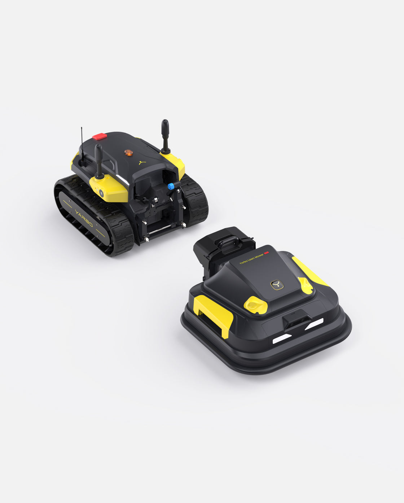
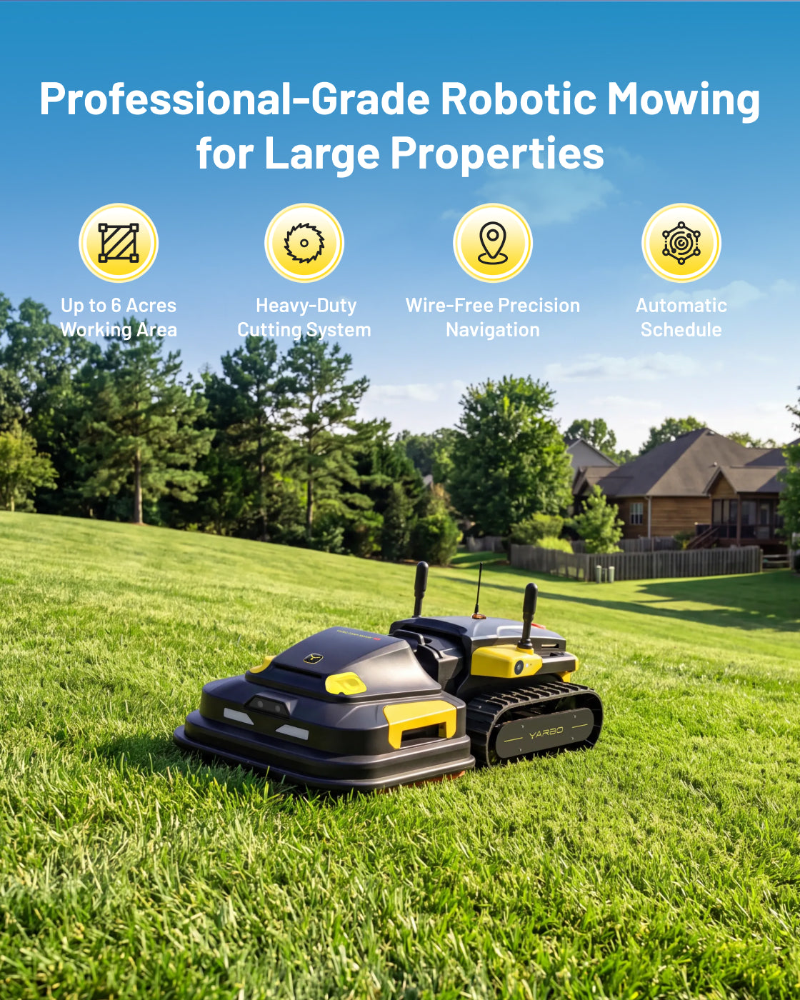
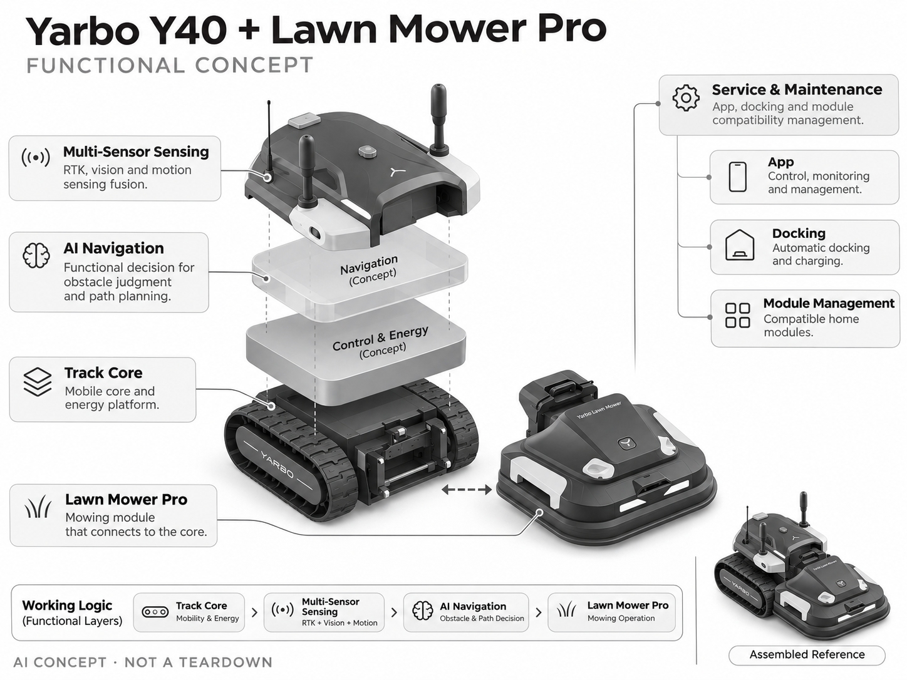

# Yarbo Y40 + Lawn Mower Pro

**Yarbo** · 庭院与自然 · 核查 2026-11-04

用一个履带核心承载大型私家庭院的自动割草

消费渠道：个人零售。

## 产品图片与结构参考

### 产品图

Yarbo Y40 + Lawn Mower Pro 官方产品图 · 来源：[Yarbo · 官方图片](<https://www.yarbo.com/products/yarbo-lawn-mower-pro>) · [原始图片](<https://cdn.shopify.com/s/files/1/0604/5394/5441/files/Lawn_Mower_pro_355adb1b-6682-4d33-be15-c244fe19eab8.jpg?v=1789445403&width=1200>)

### 参考图

Yarbo Y40 + Lawn Mower Pro 官方外观、使用场景或功能参考图 · 来源：[Yarbo · 官方图片](<https://www.yarbo.com/products/yarbo-lawn-mower-pro>) · [原始图片](<https://cdn.shopify.com/s/files/1/0604/5394/5441/files/Professional-Grade_Robotic_Mowing_for_Large_Properties.jpg?v=1793013938&width=1200>)

### AI 生成爆炸示意

**AI 生成 · 非实物拆机。** 内部为概念推断，不能作为元件布局、BOM 或维修依据。[生成提示词](../../content/hardware/prompts/yarbo-y40-lawn-mower-pro.txt)

> 保留官方图原始内容与出处；画面中的宣传参数不视为本轮独立实测。

> 分析为基于公开资料的案头研究与 AI 辅助判断，未经用户访谈、销量审计或实物拆机。需求、画像、竞争冷门度、审美及商业机会均为研究假设，不是投资结论。

## 销售与购买

- 状态：在售。官方商品页明确Y40 Core与Lawn Mower Pro Module、In Stock、预计3—8工作日和Shop Now；仅计可工作的核心加割草模块，不把配件模块或多套装重复计数。

- 地区：美国官方商店

- 价格：US$5,999。核查时官方页面参考，价格保留原币种；套装、配件、订阅、税运及地区条件分别确认，不把容量版本重复计数。

- 中国大陆：本轮核实海外官方销售；中国大陆同型号现货、售后与云服务未确认。庭院条件、物种范围或定位服务也需按地区验证。

- [官方产品 / 商店](<https://www.yarbo.com/products/yarbo-lawn-mower-pro>)

## AI 的实际作用

PPVS融合RTK、视觉相机及运动传感进行导航与障碍判断，驱动履带核心和可换家用庭院模块。

服务与联网依赖：定位、App、远程与可换模块支持需要按地区配置核对；模块化不等于每个附件都具备相同自动能力。

## 是否冷门

细分专业（研究判断）：大型私家庭院是高客单、重服务的消费细分，少见但有园艺工具和人工服务替代，不适合泛化成低门槛蓝海。

## 需求与市场

需求假设：拥有较大私家庭院的房主希望把反复割草交给自主设备，并可能复用核心做季节任务。应验证换模块、安装和救援是否抵消省时，模块多并不自动形成更低的全生命周期成本。

## 用户画像

画像推断：有较大地块、可提供停靠供电并愿意维护重型设备的家庭，而非普通公寓或小院。购买者可能已使用骑乘割草机，决策更依赖可用性、运输维修和服务，而不是单纯AI兴趣。

## 竞争与替代

竞争判断：与履带或四驱割草机器人、骑乘工具和园艺服务竞争。模块化提供可扩展性，但也增加采购和维护复杂度；是否值得用一个核心承担多任务，需要真实使用频率支持。

## 供应链

供应链分析：履带核心、电池、模块连接、刀盘与多传感导航共同构成高集成系统。实际制造工厂和BOM未披露；接口磨损、泥沙密封、重物运输和跨季节备件供应是关键成本。

## 技术路径

官方说明PPVS融合定位与视觉障碍感知。技术判断：需要验证弱卫星信号、湿滑坡地和模块负载变化下的定位控制；机械通过能力与AI识别是不同能力，不能从宣传演示推定通用自主作业。

## 产品审美

审美判断：履带与外接模块形成明显的园艺工具感，适合大地块但体量很难在小庭院隐藏。停靠、换模块抓握、线缆与非工作季收纳应与外壳一并评价，专业外观不代表家庭使用轻松。

## 关键风险

风险判断：重量、刀盘与自主移动要求可靠安全措施，孩子和动物活动时不能只依赖AI避障。模块与核心版本兼容、运输售后和地区定位服务会影响长期使用，购买前需明确实际交付配置。

## 机会与验证

机会假设：先验证一种高频庭院任务，比较自主设备与现有工具、人工服务的总劳动和总成本。若用户只偶尔换模块，平台化价值可能被高首付抵消，应避免凭扩展数量判断市场空间。

## 功能分层示意

这是功能关系，不是实物拆机、真实空间结构或已核实 BOM。

1. **履带核心**：可移动核心与能源平台。（官方披露）

2. **多传感感知**：RTK、视觉及运动传感融合。（官方披露）

3. **AI导航**：障碍与路径的功能决策层。（官方披露）

4. **割草模块**：与核心连接的Lawn Mower Pro。（官方披露）

5. **服务与维护**：App、停靠及模块兼容管理。（分析推断）

## 来源

1. [Yarbo Y40 + Lawn Mower Pro 官方商品页](<https://www.yarbo.com/products/yarbo-lawn-mower-pro>) — 已实际打开并核查购买与交付入口；未实际下单。

2. [Yarbo 官方家庭割草与AI导航说明](<https://www.yarbo.com/collections/robot-lawn-mower?p=lm>) — 已实际打开的官方能力、服务或维护说明；不代表独立实测。

[返回目录](../hardware-market.md) · [网页分析](https://romanagent.github.io/Roman/#hardware/product/yarbo-y40-lawn-mower-pro)
