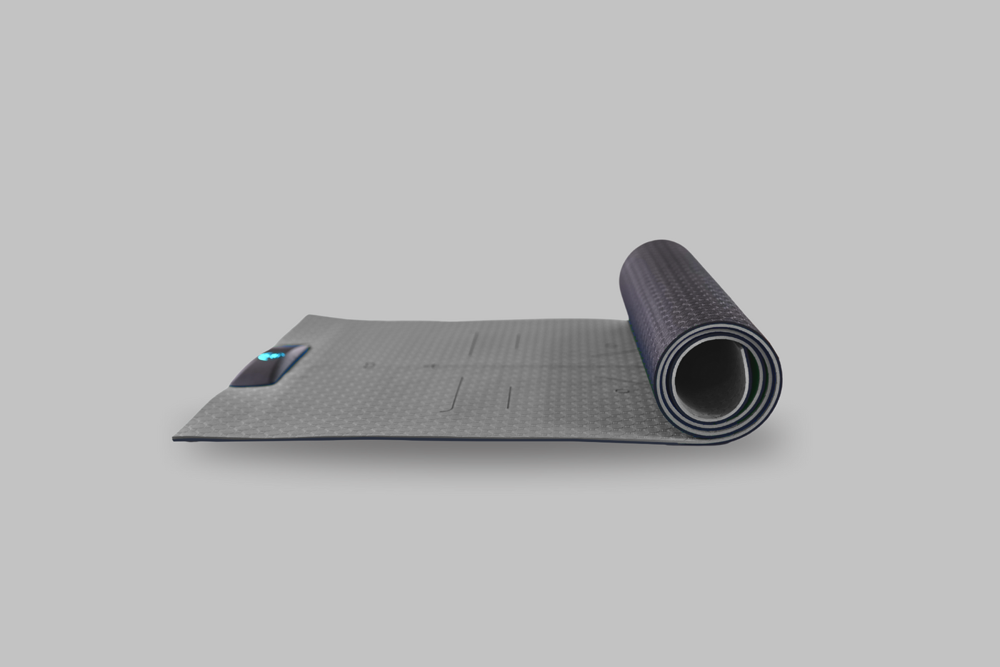
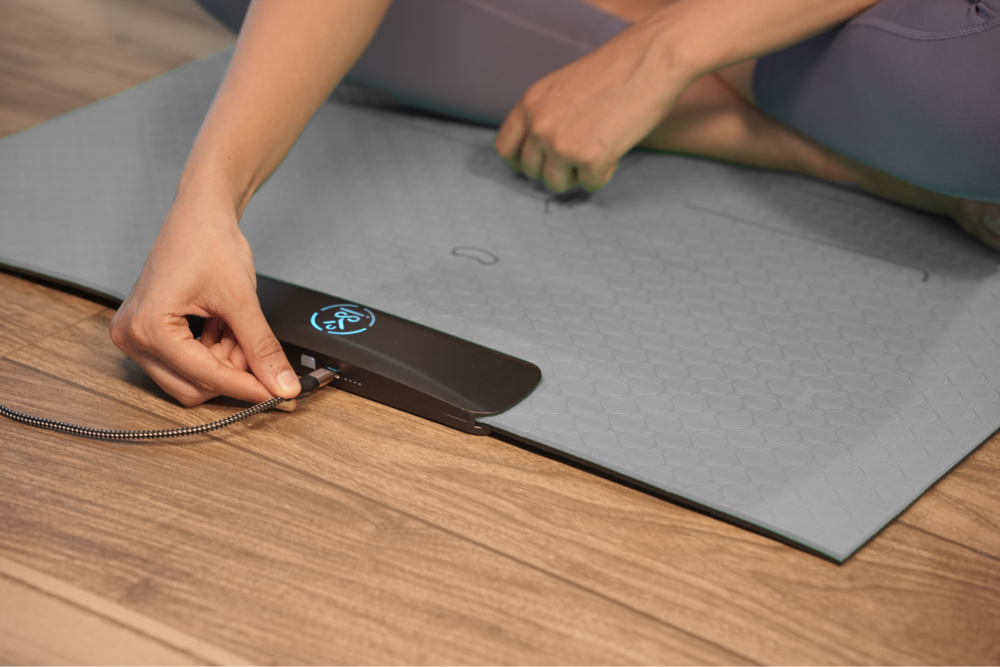
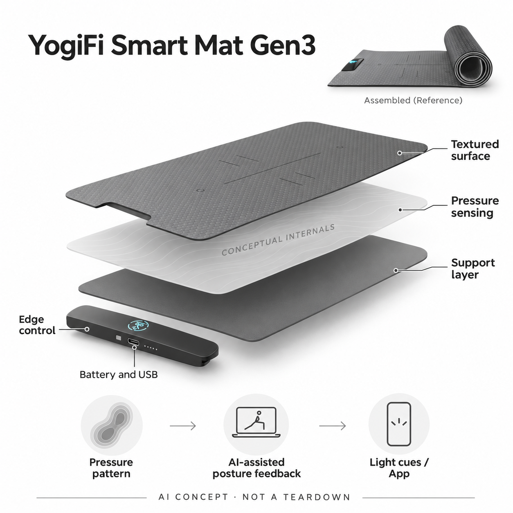

# YogiFi Smart Mat Gen3

**YogiFi** · 运动与训练 · 核查 2026-11-05

用垫内压力接触模式与灯光反馈辅助体式练习的智能瑜伽垫

消费渠道：个人零售。

## 产品图片与结构参考

### 产品图

YogiFi Gen3 Dark Gray 官方半展开产品图 · 来源：[YogiFi · 官方资料](<https://us.yogifismart.com/products/yogifi-gen3>) · [原始图片](<https://cdn.shopify.com/s/files/1/0815/0119/2404/files/38_ec1f2e7b-e8fe-412c-bb83-50124956485e.png?v=1773643945&width=1400>)

### 参考图

YogiFi Gen3 官方控制条与充电实物参考 · 来源：[YogiFi · 官方资料](<https://us.yogifismart.com/products/yogifi-gen3>) · [原始图片](<https://cdn.shopify.com/s/files/1/0815/0119/2404/files/39_dc65fb02-9933-42cb-8e4e-722affa4581e.png?v=1773643945&width=1400>)

### AI 生成爆炸示意

**AI 生成 · 非实物拆机。** 内部为概念推断，不能作为元件布局、BOM 或维修依据。[生成提示词](../../content/hardware/prompts/yogifi-smart-mat-gen3.txt)

> 以已目视核对的官方图片独立生成并完成目视QA；未知内部只作功能概念，不是实际PCB、拆机或供应商BOM。

> 保留官方图片原貌；其中宣传效果或数据不代表本站独立测量。

> 分析为基于公开资料的案头研究与 AI 辅助判断，未经用户访谈、销量审计或实物拆机。需求、画像、竞争冷门度、审美及商业机会均为研究假设，不是投资结论。

## 销售与购买

- 状态：在售。核查日美国官方店Gen3显示US$299和Add to cart；公开Dark Gray变体47656544239828为available=true。同款配色不重复计数。

- 地区：美国官方商店支持地区（目的地另核）

- 价格：美国官网US$299。同款各配色核查同价；App课程及长期服务费用未在本轮商品页完整列明，按当前计划确认，不宣称永久免费。

- 中国大陆：未核中国大陆授权零售及App和课程可用性；全球站商品可见不代表大陆配送、语言和售后条件已满足。

- [官方产品 / 商店](<https://us.yogifismart.com/products/yogifi-gen3>)

## AI 的实际作用

官方披露垫内压力传感层，结合AI体式反馈将接触模式用于练习判断，并以灯光与App视频反馈。

服务与联网依赖：通过蓝牙配YogiFi App，支持指导课程与练习后记录；具体模型、传感阵列和计算位置未披露。压力输入不等于摄像机看见全身姿态，也不直接测得心率。

## 是否冷门

细分专业（研究判断）：压力垫上反馈的输入差异明确，但普通瑜伽垫成本低、课程和老师替代直接，长期使用需验证。

## 需求与市场

案头需求是在跟随瑜伽课程时得到接触位置与稳定性反馈，补足单纯看视频不能检查自己的问题。压力垫并非完整人体测量系统，是否能帮助理解某个体式需与实际动作和老师观察对照。

### 事实：任务边界 · 官方资料

YogiFi Gen3官方披露垫内压力传感层，通过App引导练习并用灯光提供体式反馈，当前美国商店有明确价格和可购买变体。它的输入来自身体与垫面的接触，而不是一台拍摄全身的摄像机；本条只记录这一具体链路，不把普通视频课程全部算成AI能力。

依据：[YogiFi Smart Mat Gen3官方商店](<https://us.yogifismart.com/products/yogifi-gen3>) · [YogiFi压力传感与工作流程](<https://us.yogifismart.com/pages/how-mat-works>)

### 判断：真实需求 · 研究判断

需求判断是已有垫上练习者希望知道手脚位置或接触稳定性是否接近要求，减少只看屏幕却不了解自身动作的落差。压力分布能补充信息，却不能完整描述所有关节；如果用户把绿灯当成全身姿态正确，反馈也可能产生不恰当的信心。

依据：[YogiFi Smart Mat Gen3官方商店](<https://us.yogifismart.com/products/yogifi-gen3>) · [YogiFi压力传感与工作流程](<https://us.yogifismart.com/pages/how-mat-works>)

### 验证：任务完成 · 待验证

验证可以选取少数明确接触目标的体式，由老师观察同时记录垫子提示，检查哪些错误能被发现、哪些无法反映。让参与者说明提示后怎样调整，再比较普通垫加视频的流程；不能以系统评分或灯色变化直接证明健康、柔韧或姿态改善。

依据：[YogiFi Smart Mat Gen3官方商店](<https://us.yogifismart.com/products/yogifi-gen3>) · [YogiFi压力传感与工作流程](<https://us.yogifismart.com/pages/how-mat-works>)

## 用户画像

潜在用户是已有垫上练习习惯、愿意连接App且希望获得即时提示的人。对完全没有动作基础或需要康复指导的人，消费反馈不能代替专业评估；空间、垫面触感与课程习惯影响适配。

### 事实：使用条件 · 官方资料

产品需要手机App、蓝牙配对及供电，边缘控制条承担连接与状态交互，垫面可卷起收纳。官方介绍有练习后总结和课程，但本轮没有获得完整长期收费条件；海外商店可见也不代表大陆配送、语言、App分发和售后已经核实。

依据：[YogiFi Smart Mat Gen3官方商店](<https://us.yogifismart.com/products/yogifi-gen3>) · [YogiFi压力传感与工作流程](<https://us.yogifismart.com/pages/how-mat-works>)

### 判断：人群筛选 · 研究判断

潜在用户是已有瑜伽或垫上练习习惯、愿意跟随数字课程并理解反馈边界的人。完全初学者可能需要面对面的解释，熟练者又可能不愿被固定课程限制；是否适配应看练习习惯、身体接触方式和实际空间，而不是按年龄或健康目标简单划分。

依据：[YogiFi Smart Mat Gen3官方商店](<https://us.yogifismart.com/products/yogifi-gen3>) · [YogiFi压力传感与工作流程](<https://us.yogifismart.com/pages/how-mat-works>)

### 验证：参与者差异 · 待验证

访谈可询问过去几周练习地点、课程来源和最难自查的动作，观察用户是否愿意每次配对与充电。试用后记录何时依赖灯光、何时选择忽略，以及清洁收纳是否影响再次使用；不把“想更健康”的广泛愿望当作购买智能垫的充分证据。

依据：[YogiFi Smart Mat Gen3官方商店](<https://us.yogifismart.com/products/yogifi-gen3>) · [YogiFi压力传感与工作流程](<https://us.yogifismart.com/pages/how-mat-works>)

## 竞争与替代

替代包括普通瑜伽垫、镜子、摄像头姿态App和现场老师。垫内输入减少对拍摄机位的依赖，但只能感知接触和受力相关信息；这是垫上反馈任务，不重复按普通力量训练器械分组。

### 事实：方案范围 · 官方资料

压力垫与普通瑜伽垫、镜子、手机摄像头姿态识别和现场老师各有不同输入。它减少了对摄像机机位的依赖，却不能观察所有身体部位；目录将其归为垫上压力反馈任务，与自由重量和拉索力量训练区分，不把同款颜色另列成新产品。

依据：[YogiFi Smart Mat Gen3官方商店](<https://us.yogifismart.com/products/yogifi-gen3>) · [YogiFi压力传感与工作流程](<https://us.yogifismart.com/pages/how-mat-works>)

### 判断：替代关系 · 研究判断

竞争判断应看用户希望被检查的具体问题。如果目标只是跟随课程，普通垫已经够用；如果需要身体外形和关节位置，视觉或老师可能更直接；如果关注接触与稳定模式，压力输入才可能提供额外信息。不能因为没有摄像头就宣称全面更好。

依据：[YogiFi Smart Mat Gen3官方商店](<https://us.yogifismart.com/products/yogifi-gen3>) · [YogiFi压力传感与工作流程](<https://us.yogifismart.com/pages/how-mat-works>)

### 验证：比较方法 · 待验证

比较时保持相同课程和体式，让参与者分别使用普通垫、镜子或摄像头工具与YogiFi，并由独立观察者记录差异。把设置、误提示和理解成本一起计算，询问用户为何保留某种方式；不以传感器数量、AI名称或课程库大小代替实际任务判断。

依据：[YogiFi Smart Mat Gen3官方商店](<https://us.yogifismart.com/products/yogifi-gen3>) · [YogiFi压力传感与工作流程](<https://us.yogifismart.com/pages/how-mat-works>)

## 供应链

系统包括柔性压力层、支撑材料、边缘控制、电池和蓝牙，真实传感厂及工厂未披露。单点压力器件不等于整垫阵列，更不等于AI模型；布置、标定、弯折与长期漂移需要系统工程。

### 事实：功能组成 · 官方资料

官方公开压力感知层、纹理垫面、支撑层、边缘控制、充电与蓝牙，真实传感厂、阵列位置和整机工厂未披露。Tekscan或Interlink等供应商只提供可评估的压力器件与定制能力，单点传感器既不是整张垫子，也不自动具备AI体式分析。

依据：[YogiFi Smart Mat Gen3官方商店](<https://us.yogifismart.com/products/yogifi-gen3>) · [YogiFi压力传感与工作流程](<https://us.yogifismart.com/pages/how-mat-works>)

### 判断：交付约束 · 研究判断

工程判断，整垫需要解决压力布置、采样、标定、接触面积和长期漂移，卷起与清洁也可能改变机械条件。算法在一种地板和一类身体接触上有效，不代表所有用户都相同；材料舒适与感知可靠性需要共同设计，而不能分别优化后直接相加。

依据：[YogiFi Smart Mat Gen3官方商店](<https://us.yogifismart.com/products/yogifi-gen3>) · [YogiFi压力传感与工作流程](<https://us.yogifismart.com/pages/how-mat-works>)

### 验证：选型缺口 · 待验证

原型应在不同地面、接触区域和重复弯折后核对读数，记录迟滞、温度和压力保持等条件，再讨论阵列方案。候选企业需要收到完整场景要求而不是只询价一个器件；没有品牌公开采用证据前，不把它们登记成YogiFi的真实供应商或算法伙伴。

依据：[YogiFi Smart Mat Gen3官方商店](<https://us.yogifismart.com/products/yogifi-gen3>) · [YogiFi压力传感与工作流程](<https://us.yogifismart.com/pages/how-mat-works>)

## 技术路径

官方明确压力感知和AI体式反馈链路，但没有给出模型结构、阵列细节或计算位置。应区分压力模式与全身关节姿态，App提到心率或热量也不证明垫子直接具有相应生理传感器。

### 事实：AI机制 · 官方资料

官方工作原理说明压力传感器参与体式和对齐反馈，指示灯给出不同状态，App呈现课程及练习记录；没有披露模型细节、计算具体放在何处或整垫电极布局。页面出现心率和热量字段，也不足以证明垫子本身直接测量这些生理数据。

依据：[YogiFi Smart Mat Gen3官方商店](<https://us.yogifismart.com/products/yogifi-gen3>) · [YogiFi压力传感与工作流程](<https://us.yogifismart.com/pages/how-mat-works>)

### 判断：系统边界 · 研究判断

分析上，压力模式只是身体姿态的部分投影，相同接触可能对应不同关节角度，离开垫面的肢体更难由压力直接判断。AI可以从已有模式推断，却不能消除信息缺口；功能说明应让用户知道哪些反馈来自实际接触，哪些属于算法推断。

依据：[YogiFi Smart Mat Gen3官方商店](<https://us.yogifismart.com/products/yogifi-gen3>) · [YogiFi压力传感与工作流程](<https://us.yogifismart.com/pages/how-mat-works>)

### 验证：算法与体验 · 待验证

技术验证可选接触明确和接触相似但姿态不同的动作，比较老师观察与灯光提示，记录假阳性和假阴性。还要测试偏离垫面、地面不平和边缘接触，说明测试版本与人群条件；不能用一张漂亮热图证明设备知道全身姿态。

依据：[YogiFi Smart Mat Gen3官方商店](<https://us.yogifismart.com/products/yogifi-gen3>) · [YogiFi压力传感与工作流程](<https://us.yogifismart.com/pages/how-mat-works>)

## 产品审美

灰色纹理长垫可卷起，短边控制条承担连接、充电与状态反馈。分析上，脚掌和手掌触感、边缘硬件位置、清洁和收纳会影响持续使用；不能根据无人物产品图推断防滑或舒适效果。

### 事实：外观与交互 · 官方资料

真实图片显示灰色长方形纹理垫、定位线与短边黑色控制条，卷起后仍保留边缘电子部分，充电线接在控制条上。生成图把柔性层与控制功能概念分开，未画成真实电极网格，也没有额外添加摄像头、心率传感器或投影模块来补充未公开能力。

依据：[YogiFi Smart Mat Gen3官方商店](<https://us.yogifismart.com/products/yogifi-gen3>) · [YogiFi压力传感与工作流程](<https://us.yogifismart.com/pages/how-mat-works>)

### 判断：使用中的形态 · 研究判断

审美与交互判断应关注手掌和脚掌的触感、边缘硬件是否干涉动作，以及灯光在练习中是否容易看到。可卷起形态延续普通瑜伽垫习惯，但电子条增加充电和维护；图像中的整洁线条不能证明长时接触、防滑或收纳都已经适配用户。

依据：[YogiFi Smart Mat Gen3官方商店](<https://us.yogifismart.com/products/yogifi-gen3>) · [YogiFi压力传感与工作流程](<https://us.yogifismart.com/pages/how-mat-works>)

### 验证：日常接受度 · 待验证

让参与者按平时习惯铺开、连接、练习、清洁和收起，记录何处需要改变动作或查看手机。比较暗光与日光下能否读懂状态，再询问控制条位置是否造成顾虑；不能根据灰色材质或厂商无人物展示图推断实际舒适和耐用。

依据：[YogiFi Smart Mat Gen3官方商店](<https://us.yogifismart.com/products/yogifi-gen3>) · [YogiFi压力传感与工作流程](<https://us.yogifismart.com/pages/how-mat-works>)

## 关键风险

风险在过度相信绿灯、安装或地面差异引起误判，以及课程服务变化。垫子不能看到所有身体部位，异常疼痛或医疗需求不由设备判断；清洁、弯折和充电须遵循当前说明。

### 事实：已知限制 · 官方资料

官方提供体式反馈与App记录，但本轮未核完整服务收费、国内分发和独立准确性验证，模型与传感布局也未公开。消费练习产品不等于医疗评估，灯光提示更不构成动作安全认证；本条不会将厂商健康口号转写成治疗或伤害预防结论。

依据：[YogiFi Smart Mat Gen3官方商店](<https://us.yogifismart.com/products/yogifi-gen3>) · [YogiFi压力传感与工作流程](<https://us.yogifismart.com/pages/how-mat-works>)

### 判断：失效影响 · 研究判断

风险判断包括过度相信绿灯、错误提示打断练习、地面或接触差异导致推断失准，以及云或课程服务变化后硬件价值下降。用户需要理解自己身体反馈和专业指导的优先性；算法不知道所有个人情况，不能用统一得分决定应该做什么动作。

依据：[YogiFi Smart Mat Gen3官方商店](<https://us.yogifismart.com/products/yogifi-gen3>) · [YogiFi压力传感与工作流程](<https://us.yogifismart.com/pages/how-mat-works>)

### 验证：风险处理 · 待验证

应先核当前说明中的充电、清洁、卷折和使用条件，再在常规练习范围观察反馈。模拟断连与电量不足时的提示，检查历史记录、退订和换手机后的访问；若有疼痛或健康需求，应由合适专业人员评估，不把目录分析当个体练习建议。

依据：[YogiFi Smart Mat Gen3官方商店](<https://us.yogifismart.com/products/yogifi-gen3>) · [YogiFi压力传感与工作流程](<https://us.yogifismart.com/pages/how-mat-works>)

## 机会与验证

可验证机会是让已有练习者理解一两个明确接触目标。用固定体式同步老师观察和垫子反馈，记录误提示、修正与停用原因，再比较普通垫加视频的流程，不以AI分数预测健康改善。

### 判断：可尝试切口 · 研究判断

机会假设在把一两个难以自查的接触目标解释清楚，让数字课程和真实垫面之间形成有用反馈。它不必覆盖所有瑜伽动作，也不应以替代老师为唯一目标；边界清楚、反馈能被理解的细任务，可能比广泛宣称AI懂全身更有实际价值。

依据：[YogiFi Smart Mat Gen3官方商店](<https://us.yogifismart.com/products/yogifi-gen3>) · [YogiFi压力传感与工作流程](<https://us.yogifismart.com/pages/how-mat-works>)

### 判断：商业边界 · 研究判断

商业分析要考虑普通垫的低成本、课程习惯和电子维护带来的额外负担。用户可能愿意为一次校准或线下课程付费，却不愿维持另一订阅；本轮没有可核留存、销量或健康结果，不能由技术新颖和市场冷门推断长期需求一定成立。

依据：[YogiFi Smart Mat Gen3官方商店](<https://us.yogifismart.com/products/yogifi-gen3>) · [YogiFi压力传感与工作流程](<https://us.yogifismart.com/pages/how-mat-works>)

### 验证：下一步调研 · 待验证

建议跟踪已有练习者数周，记录提示被采纳、被忽略和引起困惑的具体时刻，并核对老师观察。结束访谈让用户选择继续智能垫、保留普通垫或只用课程，说明真实原因；用这些行为完善假设，不靠模型评分预测用户改善或商业成功。

依据：[YogiFi Smart Mat Gen3官方商店](<https://us.yogifismart.com/products/yogifi-gen3>) · [YogiFi压力传感与工作流程](<https://us.yogifismart.com/pages/how-mat-works>)

## 对应供应链公司

能力候选用于选型研究，不代表本产品实际采用；未公开的供货关系不作推断。

- [tekscan](../supply-chain/tekscan.md) — **能力候选 · 非已采用** / 整垫压力感知方案候选：Tekscan提供FlexiForce器件、信号调理条件和定制压力感知能力，可用于整垫方案论证；单点A201并不等于现成瑜伽垫阵列，需要另做布置、采样与标定。YogiFi没有披露采用该公司，本关联不代表真实器件或AI模型来源。

- [interlink-electronics](../supply-chain/interlink-electronics.md) — **能力候选 · 非已采用** / 柔性压力器件与定制布置候选：Interlink的FSR系列和定制传感服务可作为柔性垫面接触采集的候选路线，但迟滞、负载面积、弯折和长期漂移需在整垫条件验证。其器件不能直接等同体式模型，品牌也未点名采用，故仅登记能力匹配。

- [grepow](../supply-chain/grepow.md) — **能力候选 · 非已采用** / 边缘控制条电池候选：Grepow的小型定制电池能力可用于评估边缘控制条的空间、充电及保护方案，柔性垫卷起后对电池和线束的影响仍需工程测试。实际供应来源未披露，不从官方外观或生成示意推断YogiFi的容量、形状或采用关系。

[浏览供应链目录](../supply-chain.md)

## 功能分层示意

这是功能关系，不是实物拆机、真实空间结构或已核实 BOM。

1. **接触表面**：带纹理与定位线的柔性垫面承接手脚接触。（官方披露）

2. **压力感知层**：官方披露嵌入压力传感器，具体阵列布局未公开。（官方披露）

3. **控制与电源**：短边控制条、可充电电池和USB连接支持使用。（官方披露）

4. **反馈链路**：压力相关输入用于AI体式反馈，以灯光和App提供提示。（官方披露）

5. **App工作流**：蓝牙配对、视频课程与练习总结；模型部署位置和额外生理数据来源未充分披露。（官方披露）

## 来源

1. [YogiFi Smart Mat Gen3官方商店](<https://us.yogifismart.com/products/yogifi-gen3>) — 实际打开并核公开商品JSON；299美元、Dark Gray在售、准确Gen3图与充电结构。

2. [YogiFi压力传感与工作流程](<https://us.yogifismart.com/pages/how-mat-works>) — 实际打开；压力层、蓝牙配对、灯光反馈与App课程。未把未披露的阵列或心率来源写成硬件事实。

[返回目录](../hardware-market.md) · [网页分析](https://romanagent.github.io/Roman/#hardware/product/yogifi-smart-mat-gen3)
