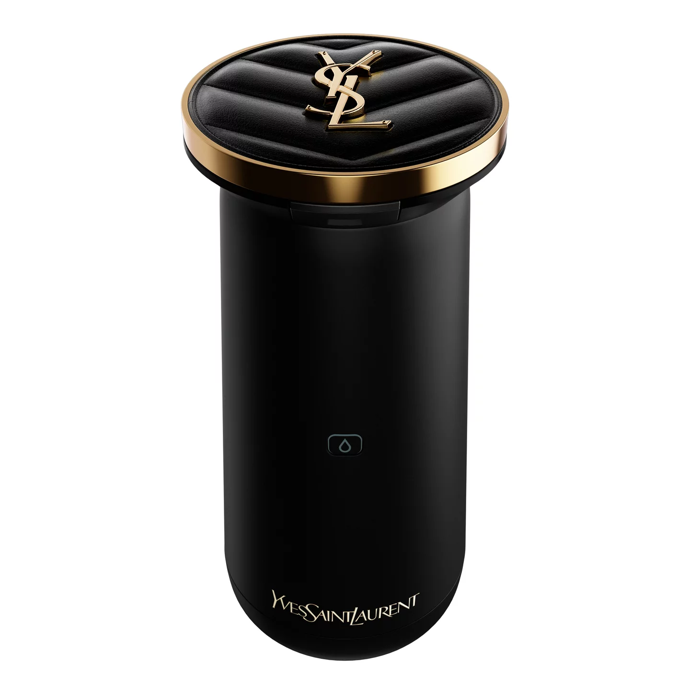
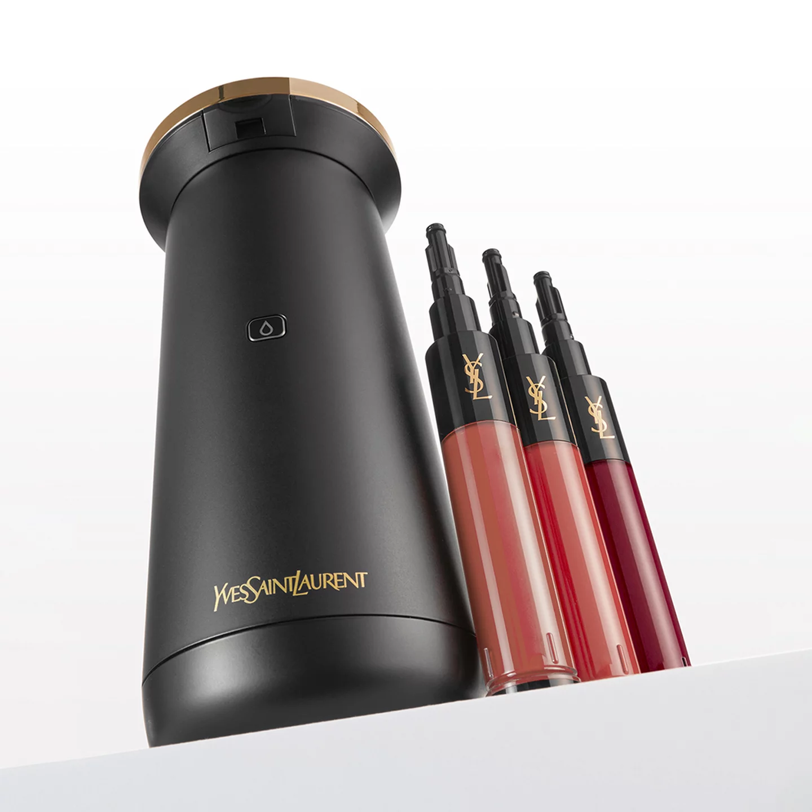
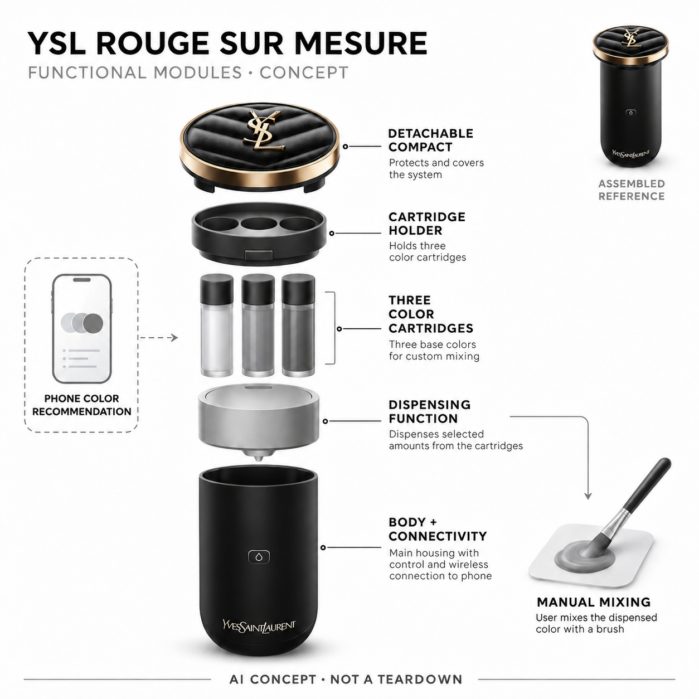

# YSL Rouge Sur Mesure

**YSL Beauty** · 护理与美容 · 核查 2026-11-04

从穿搭与照片取色推荐到实体唇彩按比例分发

消费渠道：个人零售。

## 产品图片与结构参考

### 产品图

官方整机正面 · 来源：[YSL Beauty · 官方图片](<https://www.yslbeautyus.com/rouge-sur-mesure-custom-lip-color-creator/WW-50912YSL.html>) · [原始图片](<https://www.yslbeautyus.com/dw/image/v2/AANG_PRD/on/demandware.static/-/Sites-ysl-master-catalog/default/dw07978e6b/RSM%20Packshots/Device/3614273601818.webp?sw=1440&sh=1440&sm=cut&sfrm=jpg&q=85>)

### 参考图

官方整机与专用色芯参考，色芯另购 · 来源：[YSL Beauty · 官方图片](<https://www.yslbeautyus.com/rouge-sur-mesure-custom-lip-color-creator/WW-50912YSL.html>) · [原始图片](<https://www.yslbeautyus.com/dw/image/v2/AANG_PRD/on/demandware.static/-/Sites-ysl-master-catalog/default/dw10c8fe50/RSM%20DEVICE/new/alt1.webp?sw=1440&sh=1440&sm=cut&sfrm=jpg&q=85>)

### AI 生成爆炸示意

**AI 生成 · 非实物拆机。** 内部为概念推断，不能作为元件布局、BOM 或维修依据。[生成提示词](../../content/hardware/prompts/ysl-rouge-sur-mesure.txt)

> 实际查看并核对当前型号；官方原图未改色或语义编辑，宣传文字不作为独立实测。

> 分析为基于公开资料的案头研究与 AI 辅助判断，未经用户访谈、销量审计或实物拆机。需求、画像、竞争冷门度、审美及商业机会均为研究假设，不是投资结论。

## 销售与购买

- 状态：在售。美国官方商品页实际打开显示In stock、US$350及Add to Cart；技术页面链接到同一设备。只收整机，不将色芯组合与颜色算作新产品。

- 地区：美国官网销售

- 价格：设备 US$350。官方说明色芯需另购；配色三支组、耗材和地区税费以当前结算为准，不把历史US$300或套装价当当前设备价。

- 中国大陆：已核到美国官网现货；中国市场有历史发布报道，但本次未确认中国大陆当前官方库存和售后，不能沿用2021年上市记录判断今日可购。

- [官方产品 / 商店](<https://www.yslbeautyus.com/rouge-sur-mesure-custom-lip-color-creator/WW-50912YSL.html>)

## AI 的实际作用

官方明确AI用于推荐唇色，并通过手机图像取色与穿搭搭配；PERSO设备按选定方案分发色芯，用户仍需手工混匀和涂抹。

服务与联网依赖：需兼容手机应用、蓝牙与专用色芯；拍摄在手机上完成，设备本体未披露摄像头或完整端侧模型。

## 是否冷门

细分专业（研究判断）：面向高频配色和个性化美妆，硬件材料分发有明确任务，但专用耗材与步骤限制受众；高端品牌不等于空白市场。

## 需求与市场

需求假设：经常尝试不同唇色的人希望减少逐支购买与寻找相近色号的劳动，同时保留可重复配色。价值应从实际再用、色芯消耗和清洁验证，不能把可生成颜色数量等同每个人会使用，也不能承诺比成品口红必然便宜。

### 产品任务与边界 · 研究判断

需求假设：经常尝试不同唇色的人希望减少逐支购买与寻找相近色号的劳动，同时保留可重复配色。价值应从实际再用、色芯消耗和清洁验证，不能把可生成颜色数量等同每个人会使用，也不能承诺比成品口红必然便宜。

依据：[YSL美国官方整机商品页](<https://www.yslbeautyus.com/rouge-sur-mesure-custom-lip-color-creator/WW-50912YSL.html>) · [YSL Rouge Sur Mesure官方技术介绍](<https://www.yslbeautyus.com/rouge-sur-mesure.html?geo=false>)

### 需求判断 · 研究判断

选择一种新唇色往往涉及比对照片、试色和购买，材料分发把数字建议接到了可实际涂抹的结果。真正价值可能是少量多次尝试和再次复现，而不是替代全部成品唇彩；色芯组合、人工混匀和清洁仍构成流程，需评估总劳动与使用频率。

依据：[YSL美国官方整机商品页](<https://www.yslbeautyus.com/rouge-sur-mesure-custom-lip-color-creator/WW-50912YSL.html>) · [YSL Rouge Sur Mesure官方技术介绍](<https://www.yslbeautyus.com/rouge-sur-mesure.html?geo=false>)

### 需求验证 · 待验证

验证可让自愿参与者使用自己接受的化妆品完成选择、分发和混匀，记录再次使用同色的次数及耗材消耗。结果由本人评价，不对外貌作客观优劣判断；不能把宣传颜色总数、一次照片匹配或品牌溢价当作市场需求已经成立的证据。

依据：[YSL美国官方整机商品页](<https://www.yslbeautyus.com/rouge-sur-mesure-custom-lip-color-creator/WW-50912YSL.html>) · [YSL Rouge Sur Mesure官方技术介绍](<https://www.yslbeautyus.com/rouge-sur-mesure.html?geo=false>)

## 用户画像

画像推断：愿意使用专用应用、购买色芯并手动混匀的美妆爱好者较匹配；只用固定色号或偏好随取随涂的人可能不需要。实际肤色呈现、光线和材料接受度应由使用者判断，不按性别、年龄或身份推定审美偏好。

### 适用行为与条件 · 研究判断

画像推断：愿意使用专用应用、购买色芯并手动混匀的美妆爱好者较匹配；只用固定色号或偏好随取随涂的人可能不需要。实际肤色呈现、光线和材料接受度应由使用者判断，不按性别、年龄或身份推定审美偏好。

依据：[YSL美国官方整机商品页](<https://www.yslbeautyus.com/rouge-sur-mesure-custom-lip-color-creator/WW-50912YSL.html>) · [YSL Rouge Sur Mesure官方技术介绍](<https://www.yslbeautyus.com/rouge-sur-mesure.html?geo=false>)

### 人群取舍 · 研究判断

有探索意愿且能接受专用色芯的人，与只希望快速完成日常妆容的人存在明显差异。购买者还需要兼容手机和维护习惯，出门携带顶盘与整机常驻梳妆台是两种使用位置；画像应围绕实际行为而非性别或被模型推断的个人风格。

依据：[YSL美国官方整机商品页](<https://www.yslbeautyus.com/rouge-sur-mesure-custom-lip-color-creator/WW-50912YSL.html>) · [YSL Rouge Sur Mesure官方技术介绍](<https://www.yslbeautyus.com/rouge-sur-mesure.html?geo=false>)

### 画像验证 · 待验证

画像验证应询问常用颜色、换色频率与已有库存，再观察应用连接和清理是否成为负担。记录用户是否真正使用推荐而非仅喜欢观看演示，允许其选择固定成品；不以年龄、肤色或职业为依据断言某人必须偏好特定颜色和产品形式。

依据：[YSL美国官方整机商品页](<https://www.yslbeautyus.com/rouge-sur-mesure-custom-lip-color-creator/WW-50912YSL.html>) · [YSL Rouge Sur Mesure官方技术介绍](<https://www.yslbeautyus.com/rouge-sur-mesure.html?geo=false>)

## 竞争与替代

竞争判断：与成品唇彩、手工混色和虚拟试妆应用竞争，差异是推荐结果进入实体定量分发。色芯系列和礼盒不另算硬件创新；应比较真实配色、携带与清理，而非只看品牌或宣传中成千上万种颜色。

### 比较对象与差异 · 研究判断

竞争判断：与成品唇彩、手工混色和虚拟试妆应用竞争，差异是推荐结果进入实体定量分发。色芯系列和礼盒不另算硬件创新；应比较真实配色、携带与清理，而非只看品牌或宣传中成千上万种颜色。

依据：[YSL美国官方整机商品页](<https://www.yslbeautyus.com/rouge-sur-mesure-custom-lip-color-creator/WW-50912YSL.html>) · [YSL Rouge Sur Mesure官方技术介绍](<https://www.yslbeautyus.com/rouge-sur-mesure.html?geo=false>)

### 竞争判断 · 研究判断

虚拟试妆能够帮助选择却不提供实体材料，手工混色有自由度但难以复现比例，这两者都应纳入替代比较。专用设备可能降低重复配色难度，也把用户锁定在耗材体系里，不能只比较机器价格或宣称等于拥有成千支口红。

依据：[YSL美国官方整机商品页](<https://www.yslbeautyus.com/rouge-sur-mesure-custom-lip-color-creator/WW-50912YSL.html>) · [YSL Rouge Sur Mesure官方技术介绍](<https://www.yslbeautyus.com/rouge-sur-mesure.html?geo=false>)

### 竞争验证 · 待验证

竞争验证可对照固定成品、手工混色和设备分发，比较选择时间、清理、重复颜色与剩余耗材。将AI建议单独评估，不把不同色芯、套装和可拆盘当多种硬件品类；也不能用屏幕预览和实际唇部在不同照明下的表现直接作精度结论。

依据：[YSL美国官方整机商品页](<https://www.yslbeautyus.com/rouge-sur-mesure-custom-lip-color-creator/WW-50912YSL.html>) · [YSL Rouge Sur Mesure官方技术介绍](<https://www.yslbeautyus.com/rouge-sur-mesure.html?geo=false>)

## 供应链

供应链分析：专用化妆品色芯、计量驱动、可拆容器、控制连接和应用共同构成系统，具体代工与BOM未披露。配方稳定、残留和耗材供应影响体验，不能把它当普通打印机或虚构喷墨头、摄像模组和皮肤接触机械臂。

### 功能模块拆分 · 研究判断

整机功能包括三支色芯容纳、比例分发、可拆盘、外壳控制和手机连接，化妆品配方与电子机械均属于交付。公开资料未揭示执行器与液路细节，因此概念图不画成喷墨打印头；更换、预充、残留与材料接触是实际供应验证重点。

依据：[YSL美国官方整机商品页](<https://www.yslbeautyus.com/rouge-sur-mesure-custom-lip-color-creator/WW-50912YSL.html>) · [YSL Rouge Sur Mesure官方技术介绍](<https://www.yslbeautyus.com/rouge-sur-mesure.html?geo=false>)

### 制造与供应约束 · 研究判断

供应链分析：专用化妆品色芯、计量驱动、可拆容器、控制连接和应用共同构成系统，具体代工与BOM未披露。配方稳定、残留和耗材供应影响体验，不能把它当普通打印机或虚构喷墨头、摄像模组和皮肤接触机械臂。

依据：[YSL美国官方整机商品页](<https://www.yslbeautyus.com/rouge-sur-mesure-custom-lip-color-creator/WW-50912YSL.html>) · [YSL Rouge Sur Mesure官方技术介绍](<https://www.yslbeautyus.com/rouge-sur-mesure.html?geo=false>)

### 候选与证据缺口 · 研究判断

新金宝可作为小型消费机电整机导入候选，Protolabs可支持外壳与可拆容器的原型评估，两者未获本型号点名采用证据。化妆品配方、计量卫生和色芯密封需其他专项验证，通用制造能力不能推定已经满足化妆品产品和耗材的要求。

依据：[YSL美国官方整机商品页](<https://www.yslbeautyus.com/rouge-sur-mesure-custom-lip-color-creator/WW-50912YSL.html>) · [YSL Rouge Sur Mesure官方技术介绍](<https://www.yslbeautyus.com/rouge-sur-mesure.html?geo=false>)

## 技术路径

技术判断：官方把AI用于颜色制作与推荐，手机图像负责取色和穿搭输入；设备执行比例后仍由用户混匀。照片光线、色芯组合和显示差异都会影响结果，未披露模型架构，不把宣传色数或虚拟预览当作实物一致性证明。

### 已披露技术边界 · 研究判断

技术判断：官方把AI用于颜色制作与推荐，手机图像负责取色和穿搭输入；设备执行比例后仍由用户混匀。照片光线、色芯组合和显示差异都会影响结果，未披露模型架构，不把宣传色数或虚拟预览当作实物一致性证明。

依据：[YSL美国官方整机商品页](<https://www.yslbeautyus.com/rouge-sur-mesure-custom-lip-color-creator/WW-50912YSL.html>) · [YSL Rouge Sur Mesure官方技术介绍](<https://www.yslbeautyus.com/rouge-sur-mesure.html?geo=false>)

### 系统难点判断 · 研究判断

照片取色、穿搭推荐和分发控制是不同技术环节，前两者可能受相机白平衡、环境光与屏幕显示影响，后者又受实际色芯状态约束。模型给出建议不代表设备能实现任意色域，官方要求用户混匀也说明最终步骤并非完全由机器完成。

依据：[YSL美国官方整机商品页](<https://www.yslbeautyus.com/rouge-sur-mesure-custom-lip-color-creator/WW-50912YSL.html>) · [YSL Rouge Sur Mesure官方技术介绍](<https://www.yslbeautyus.com/rouge-sur-mesure.html?geo=false>)

### 技术验证 · 待验证

技术验证应先检查兼容色芯和应用版本，再用可重复光照比较照片输入与实际分发的稳定性，保留用户手工调整。只做说明允许的正常使用，不拆改电路或注入非兼容配方；不能由AI标签推断真实材料必然与虚拟颜色完全一致。

依据：[YSL美国官方整机商品页](<https://www.yslbeautyus.com/rouge-sur-mesure-custom-lip-color-creator/WW-50912YSL.html>) · [YSL Rouge Sur Mesure官方技术介绍](<https://www.yslbeautyus.com/rouge-sur-mesure.html?geo=false>)

## 产品审美

审美判断：黑色筒身、品牌金属细节和可拆顶盘延续化妆品摆台语言，容易融入梳妆台。实际体验还取决于出料口清洁、顶盘沾染与随身携带，不能只看包装或奢华材质，也不应将输出颜色作为个人外貌评价。

### 外观与交互语言 · 研究判断

审美判断：黑色筒身、品牌金属细节和可拆顶盘延续化妆品摆台语言，容易融入梳妆台。实际体验还取决于出料口清洁、顶盘沾染与随身携带，不能只看包装或奢华材质，也不应将输出颜色作为个人外貌评价。

依据：[YSL美国官方整机商品页](<https://www.yslbeautyus.com/rouge-sur-mesure-custom-lip-color-creator/WW-50912YSL.html>) · [YSL Rouge Sur Mesure官方技术介绍](<https://www.yslbeautyus.com/rouge-sur-mesure.html?geo=false>)

### 使用中审美判断 · 研究判断

黑色筒身、金色边缘与柔软纹理顶盘沿用奢侈化妆品视觉，能够减少实验设备感，却也强调品牌装饰。真实使用会留下色料和指纹，可拆盘的清洁及携带比宣传包装更影响长期满意度；审美评价应服务操作而非替人定义什么妆容好看。

依据：[YSL美国官方整机商品页](<https://www.yslbeautyus.com/rouge-sur-mesure-custom-lip-color-creator/WW-50912YSL.html>) · [YSL Rouge Sur Mesure官方技术介绍](<https://www.yslbeautyus.com/rouge-sur-mesure.html?geo=false>)

### 设计验证 · 待验证

设计验证可观察取下顶盘、安装色芯、清理出料口以及放回时的错误，检查各状态是否明确。让参与者在真实梳妆台和携带场景下表达偏好，不用镜头中的人物或效果图为用户设定美丽标准，也不以隐藏按钮等同完全无需学习。

依据：[YSL美国官方整机商品页](<https://www.yslbeautyus.com/rouge-sur-mesure-custom-lip-color-creator/WW-50912YSL.html>) · [YSL Rouge Sur Mesure官方技术介绍](<https://www.yslbeautyus.com/rouge-sur-mesure.html?geo=false>)

## 关键风险

风险判断：错误色芯识别、旧耗材与残留可能影响配色，用户仍须按产品说明确认成分和适用性。AI搭配建议是审美参考，不能形成皮肤健康或安全保证；应用兼容和地区耗材库存需核对，历史上市不等于当前全球可购。

### 主要失效与依赖 · 研究判断

风险判断：错误色芯识别、旧耗材与残留可能影响配色，用户仍须按产品说明确认成分和适用性。AI搭配建议是审美参考，不能形成皮肤健康或安全保证；应用兼容和地区耗材库存需核对，历史上市不等于当前全球可购。

依据：[YSL美国官方整机商品页](<https://www.yslbeautyus.com/rouge-sur-mesure-custom-lip-color-creator/WW-50912YSL.html>) · [YSL Rouge Sur Mesure官方技术介绍](<https://www.yslbeautyus.com/rouge-sur-mesure.html?geo=false>)

### 风险传播判断 · 研究判断

耗材识别错误与长时间不用后的残留可能造成颜色偏离，应用更新或色芯断货则影响长期复用。对皮肤接触材料应按官方成分和使用限制判断，AI审美建议不能代表医学或过敏安全意见，当前美国可售也不解决大陆耗材与售后问题。

依据：[YSL美国官方整机商品页](<https://www.yslbeautyus.com/rouge-sur-mesure-custom-lip-color-creator/WW-50912YSL.html>) · [YSL Rouge Sur Mesure官方技术介绍](<https://www.yslbeautyus.com/rouge-sur-mesure.html?geo=false>)

### 风险验证 · 待验证

风险验证应检查色芯安装与更换、低料提示及应用断连后的恢复，使用说明允许的材料并保留人工核对。不要用未确认配方或危险拆机测试；对历史中国上市报道仅作背景，未核到当前官方库存时不把它写成稳定的国内购买渠道。

依据：[YSL美国官方整机商品页](<https://www.yslbeautyus.com/rouge-sur-mesure-custom-lip-color-creator/WW-50912YSL.html>) · [YSL Rouge Sur Mesure官方技术介绍](<https://www.yslbeautyus.com/rouge-sur-mesure.html?geo=false>)

## 机会与验证

机会假设：可以围绕少数常用色的可靠复现和低浪费换色验证，而不是追求无穷推荐。若用户主要只保留一个色号，普通成品更简单；应记录长期色芯成本、清洁和再次使用，再判断软硬件个性化是否带来持续价值。

### 可能的机会入口 · 研究判断

机会假设：可以围绕少数常用色的可靠复现和低浪费换色验证，而不是追求无穷推荐。若用户主要只保留一个色号，普通成品更简单；应记录长期色芯成本、清洁和再次使用，再判断软硬件个性化是否带来持续价值。

依据：[YSL美国官方整机商品页](<https://www.yslbeautyus.com/rouge-sur-mesure-custom-lip-color-creator/WW-50912YSL.html>) · [YSL Rouge Sur Mesure官方技术介绍](<https://www.yslbeautyus.com/rouge-sur-mesure.html?geo=false>)

### 机会成立条件 · 研究判断

创业机会可以从可靠复色、小量输出与低清洁负担切入，让探索变得可重复。若AI推荐只带来一次新鲜感，核心价值可能仍在计量和耗材体验；因此应先识别常用场景与复购条件，再考虑扩大风格识别或更复杂的生成式搭配服务。

依据：[YSL美国官方整机商品页](<https://www.yslbeautyus.com/rouge-sur-mesure-custom-lip-color-creator/WW-50912YSL.html>) · [YSL Rouge Sur Mesure官方技术介绍](<https://www.yslbeautyus.com/rouge-sur-mesure.html?geo=false>)

### 下一步验证 · 待验证

下一步可追踪用户多次选择、同色复现和未使用色芯的去向，比较成品购买与设备方案的真实成本。用自愿使用者的持续行为判断价值，不以颜色排列组合、品牌影响力或外貌焦虑推算销量，也不承诺设备必然减少所有化妆品浪费。

依据：[YSL美国官方整机商品页](<https://www.yslbeautyus.com/rouge-sur-mesure-custom-lip-color-creator/WW-50912YSL.html>) · [YSL Rouge Sur Mesure官方技术介绍](<https://www.yslbeautyus.com/rouge-sur-mesure.html?geo=false>)

## 对应供应链公司

能力候选用于选型研究，不代表本产品实际采用；未公开的供货关系不作推断。

- [new-kinpo-group](../supply-chain/new-kinpo-group.md) — **能力候选 · 非已采用** / 便携消费机电设备导入评估：新金宝公开消费与小家电制造能力可对应外壳、控制和计量执行整合，但化妆品色芯卫生、密封和配方稳定需专项验证；未见YSL Rouge Sur Mesure点名合作资料，不能标为实际代工。

- [protolabs](../supply-chain/protolabs.md) — **能力候选 · 非已采用** / 外壳与可拆盘的原型和模具验证：Protolabs公开快速原型及模具服务可用于筒身、色芯接口和可拆盘装配验证，但材料与唇彩接触合规及计量性能并非自动满足；没有YSL型号采用证据，当前仅列结构工程候选。

[浏览供应链目录](../supply-chain.md)

## 功能分层示意

这是功能关系，不是实物拆机、真实空间结构或已核实 BOM。

1. **色芯与安装仓**：容纳三支兼容专用色芯。（官方披露）

2. **计量分发**：根据选择输出比例，内部驱动和液路未完整披露。（官方披露）

3. **可拆调色盘**：用于接收、手工混匀和携带唇彩。（官方披露）

4. **控制与连接**：蓝牙和电源控制功能层，具体电子器件未披露。（分析推断）

5. **手机识别与推荐**：照片取色和穿搭唇色建议属于应用端服务。（官方披露）

## 来源

1. [YSL美国官方整机商品页](<https://www.yslbeautyus.com/rouge-sur-mesure-custom-lip-color-creator/WW-50912YSL.html>) — 实际打开In stock及加入购物车；明确用户混匀和应用兼容，未下单。

2. [YSL Rouge Sur Mesure官方技术介绍](<https://www.yslbeautyus.com/rouge-sur-mesure.html?geo=false>) — 实际打开AI推荐、照片取色与穿搭搭配说明；色芯另购，营销色数不作实测。

[返回目录](../hardware-market.md) · [网页分析](https://romanagent.github.io/Roman/#hardware/product/ysl-rouge-sur-mesure)
