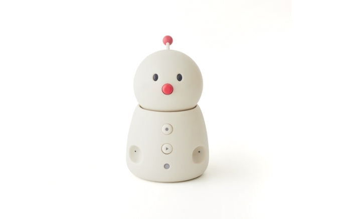
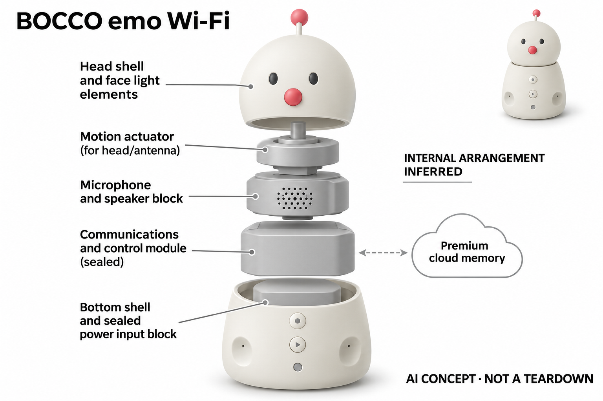

# BOCCO emo Wi-Fi

**Yukai Engineering** · 陪伴与宠物 · 核查 2026-11-04

把家庭留言与记忆会话放进同一机器人

消费渠道：个人零售。

## 产品图片与结构参考

### 产品图

BOCCO emo Wi-Fi · 官方产品图 · 来源：[Yukai Engineering · 官方图片](<https://store.ux-xu.com/products/bocco-emo>) · [原始图片](<https://store.ux-xu.com/cdn/shop/products/product_bocco_emo.jpg?v=1592317204&width=1946>)

### 参考图

BOCCO emo Wi-Fi · 官方参考图 · 来源：[Yukai Engineering · 官方图片](<https://store.ux-xu.com/products/bocco-emo>) · [原始图片](<https://store.ux-xu.com/cdn/shop/products/img_bocco_emo_01.jpg?v=1592987067&width=1946>)

### AI 生成爆炸示意

**AI 生成 · 非实物拆机。** 内部为概念推断，不能作为元件布局、BOM 或维修依据。[生成提示词](../../content/hardware/prompts/yukai-bocco-emo.txt)

> 已目视核对外形、标签与非拆机声明；不代表内部结构经实测验证。

> 分析为基于公开资料的案头研究与 AI 辅助判断，未经用户访谈、销量审计或实物拆机。需求、画像、竞争冷门度、审美及商业机会均为研究假设，不是投资结论。

## 销售与购买

- 状态：在售。官方商店可加购，结构化商品Offer为InStock；标准Wi-Fi本体只计一款，LTE租赁方案不重复计数。

- 地区：日本

- 价格：本体 ¥33,000；自然会话方案 ¥1,700/月。核查日页面快照；运费、税费、会员和配送区域按官方结算确认，不视为中国到手价。

- 中国大陆：本轮核实所列区域官方商店；未确认中国大陆官方现货、账户及完整服务，不把境外可购等同大陆可用。

- [官方产品 / 商店](<https://store.ux-xu.com/products/bocco-emo>)

## AI 的实际作用

语音识别及消息转写支持家庭通信；当前Premium方案支持自然会话、声纹区分和会话记忆。基础免费功能与新增自然会话服务分别列明。

服务与联网依赖：需要Wi-Fi、手机应用与账户；自然会话需Premium和指定版本更新。官方明确不能提供所有实时新闻或附近商家信息。

## 是否冷门

新兴竞争（研究判断）：面向日语家庭的固定摆放陪伴形成具体使用场景；本轮没有销量与市场份额证据。

## 需求与市场

需求假设：异地家庭可能希望消息传递具有声音和角色回应，同时在日常独处时进行短会话。应分别观察家人真实留言量和用户主动聊天量，确认两种价值是否共存而非相互替代。

## 用户画像

画像推断：有日语使用环境、固定网络和能够管理家庭账户的人较匹配。购买者可能是远方家属，使用者可能不常用手机，因此配网、房间所有者权限和后续服务续费需有人负责。

## 竞争与替代

竞争判断：视频通话、智能音箱和日语陪伴机器人都能满足部分需求，BOCCO的差异是家庭消息与角色记忆结合。已有通信习惯未必愿意迁移，不能仅由功能更多推断家庭接受度。

## 供应链

供应链推断：固定底座的麦克风、灯光、动作机构和通信模块需要与持续云服务配合。官方未披露完整工厂和物料表；家庭成员换机、网络变更及软件升级也会产生服务成本。

## 技术路径

官方说明注册声音后可区分家庭成员并保存相关记忆。技术判断需测试相似声音误认、多人轮流说话与背景电视干扰，不能把记忆能力写成准确无误的人物理解或实时知识查询。

## 产品审美

审美判断：白色圆润身体、会发光的脸颊和顶部摆动部件形成柔和家居角色，表达不依赖大屏幕。固定位置的可听性和夜间灯光会影响相处体验，应该在真实房间而非静物照片中评估。

## 关键风险

风险判断：Premium费用、家庭账户权限和会话历史可见范围必须明确；官方提醒电视可能误触发。重要通信不宜完全依赖单一设备，角色回应也不能视作对生活或健康问题的可靠判断。

## 机会与验证

市场观察：本款适合研究旧家庭通信硬件叠加自然会话后是否增加留存。可分开记录留言完成率、声纹纠错和付费后的主动交流，避免把新功能上线或旧用户故事当成新的市场证据。

## 功能分层示意

这是功能关系，不是实物拆机、真实空间结构或已核实 BOM。

1. **家庭输入**：语音与应用消息进入同一家庭房间。（官方披露）

2. **识别转写**：语音识别和注册声音区分。（官方披露）

3. **会话记忆**：Premium支持自然会话与记忆。（官方披露）

4. **具身输出**：声音、脸颊灯和动作反馈。（官方披露）

## 来源

1. [BOCCO emo官方商店](<https://store.ux-xu.com/products/bocco-emo>) — 已实际打开官方页面；功能说明不等于独立性能测量。

2. [BOCCO emo当前Premium功能](<https://www.bocco.me/living/premium/>) — 已实际打开官方页面；功能说明不等于独立性能测量。

3. [BOCCO emo基础功能](<https://www.bocco.me/en/?language=en>) — 已实际打开官方页面；功能说明不等于独立性能测量。

[返回目录](../hardware-market.md) · [网页分析](https://romanagent.github.io/Roman/#hardware/product/yukai-bocco-emo)
