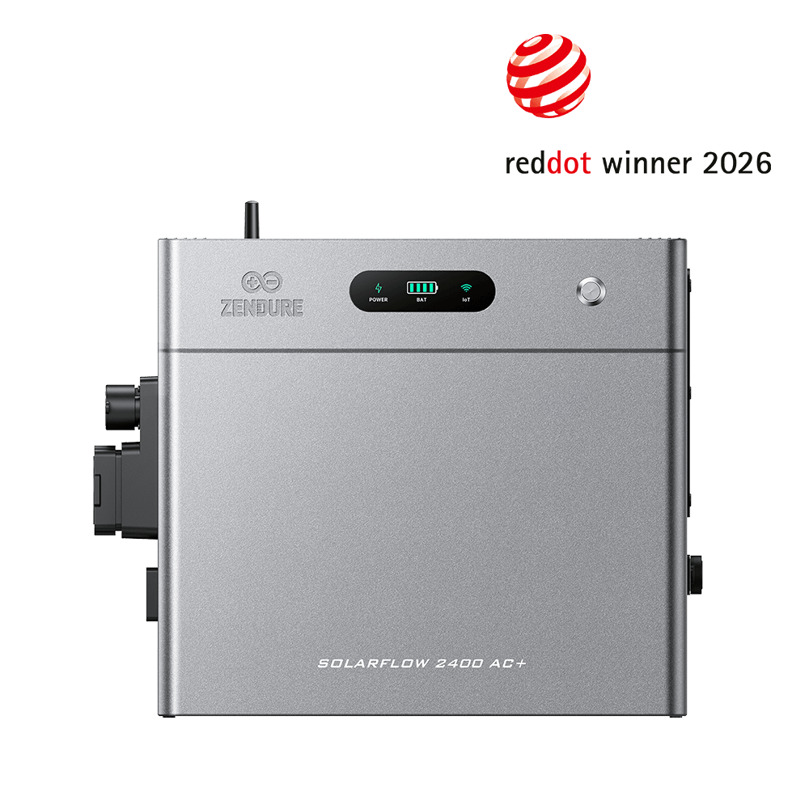
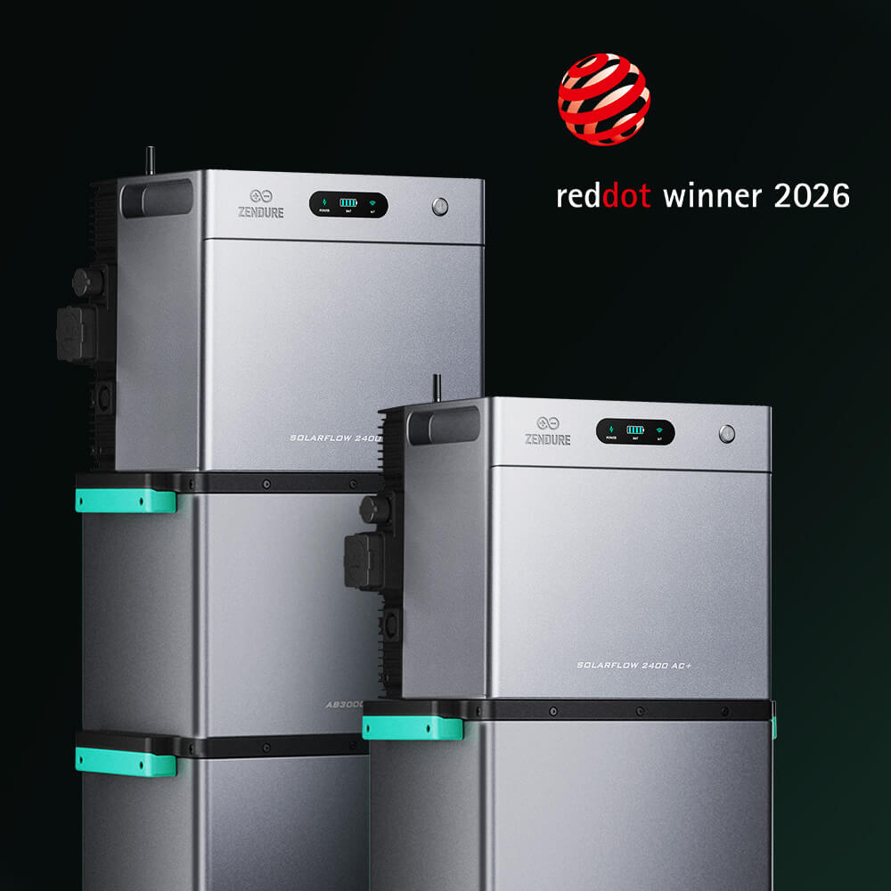
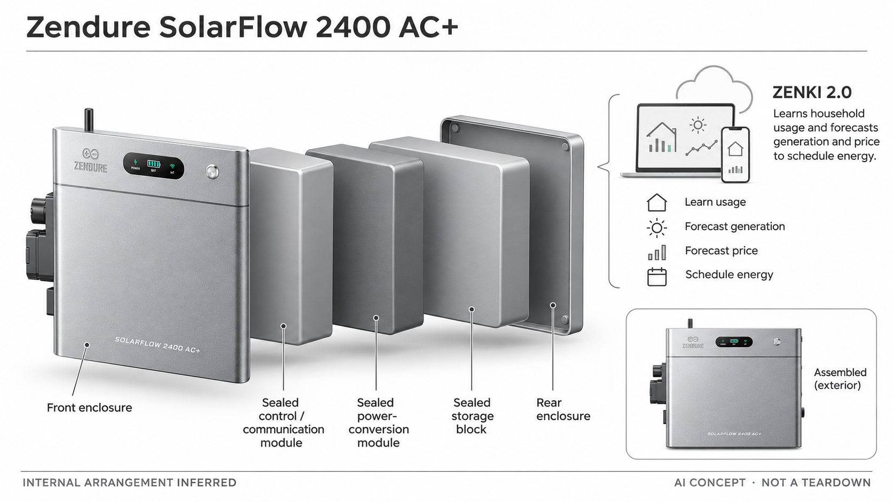

# Zendure SolarFlow 2400 AC+

**Zendure** · 家庭能源 · 核查 2026-11-04

用家庭用能预测和电价预测管理可扩展AC储能。

消费渠道：个人零售。

## 产品图片与结构参考

### 产品图

Zendure SolarFlow 2400 AC+官方产品图 · 来源：[Zendure](<https://zendure.com/products/zendure-solarflow-2400-ac-plus>) · [原始图片](<https://zendure.com/cdn/shop/files/2400AC_-reddot.png?v=1777288956&width=1080>)

### 参考图

官方扩展电池叠放参考；扩展模块不默认包含于基础配置 · 来源：[Zendure](<https://zendure.com/products/zendure-solarflow-2400-ac-plus>) · [原始图片](<https://zendure.com/cdn/shop/files/2400AC_-reddot_2.jpg?v=1777288954&width=1080>)

### AI 生成爆炸示意

**AI 生成 · 非实物拆机。** 内部为概念推断，不能作为元件布局、BOM 或维修依据。[生成提示词](../../content/hardware/prompts/zendure-solarflow-2400-ac-plus.txt)

> 分析为基于公开资料的案头研究与 AI 辅助判断，未经用户访谈、销量审计或实物拆机。需求、画像、竞争冷门度、审美及商业机会均为研究假设，不是投资结论。

## 销售与购买

- 状态：在售。当前欧盟商品页展示Add to cart及3–5个工作日库存说明。不同扩展电池和智能电表套装合并，不能把旧2400 AC与AC+的规格混用。

- 地区：欧盟官方商店

- 价格：欧盟页面 €839 起（所选基础配置）。为所标地区和配置的核查参考；活动、税费、物流及可选服务以实际结算为准，不进行汇率换算或保证最低价。

- 中国大陆：本轮核查欧盟型号和销售页；中国大陆供货、计量接入、安装与售后未验证，不将跨境购买等同于当地完整可用。

- [官方产品 / 商店](<https://zendure.com/products/zendure-solarflow-2400-ac-plus>)

## AI 的实际作用

官方描述ZENKI 2.0学习使用模式并预测光伏产出及价格，用于充放电计划；硬件负责储能与执行。

服务与联网依赖：联网、App、支持的计量和电价数据共同影响AI计划。部分系统配置或服务可能另计，不将所有配套能力视为基础包内置。

## 是否冷门

新兴竞争（研究判断）：家庭能源调度属于消费电子中的细分场景，但与多品牌储能及人工策略竞争，不代表未经开发的蓝海。

## 需求与市场

需求假设：拥有屋顶或阳台光伏的家庭，希望在用电与发电不一致时更方便地管理能量。AI的价值应体现在更少操作和更合理的计划，而不是仅仅因为电池具有联网功能。

### 任务与触发场景 · 研究判断

SolarFlow 2400 AC+的官方定位包含为既有屋顶光伏增加交流侧储能的改造场景，其需求不同于从零购买一整套系统。用户可能希望保留原有设备，再增加存储和策略能力。研究首先要确认既有配置的约束和希望解决的用电时段问题，不能把所有光伏家庭都视为同样适配。

依据：[SolarFlow 2400 AC+ 欧盟官方店](<https://zendure.com/products/zendure-solarflow-2400-ac-plus>) · [Zendure HEMS 官方说明](<https://pl.zendure.com/pages/hems>)

### 流程中的收益与代价 · 研究判断

在既有系统上增加设备，可能减少重新规划的范围，也会带来接口、计量、空间和维护协作。AI计划能否降低操作负担，取决于可用数据和日常负载变化。应把不加储能、使用简单时段策略和学习型计划分别比较，不能只凭改造方便或智能调度的宣传判断价值。

依据：[SolarFlow 2400 AC+ 欧盟官方店](<https://zendure.com/products/zendure-solarflow-2400-ac-plus>) · [Zendure HEMS 官方说明](<https://pl.zendure.com/pages/hems>)

### 需求如何验证 · 待验证

建议在适配系统及专业支持下记录发电、负载、计划和实际执行，并让家庭解释为何接受或修改策略。完整投入应包含配套与维护，不只是主机标价。当前没有实际家庭账单、安装成本和长期对照，因此不承诺固定节省、通用回本周期或所有原有系统都能兼容。

依据：[SolarFlow 2400 AC+ 欧盟官方店](<https://zendure.com/products/zendure-solarflow-2400-ac-plus>) · [Zendure HEMS 官方说明](<https://pl.zendure.com/pages/hems>)

## 用户画像

画像推断：愿意维护能源设备并有稳定用电场景的住户，通常已经理解光伏或储能基础。不同住宅的安装、计量和电价条件差异很大，不宜用统一画像假设所有家庭都有相同回报。

### 优先使用者 · 研究判断

优先画像是已有光伏或明确储能改造计划、希望在既有家庭系统上继续扩展的个人用户。房屋、计量、设备与服务条件比抽象环保态度更能解释购买。需要确认用户掌握多少现有系统信息，以及是否有专业支持，不能把普通线上下单能力等同完成所有适配工作。

依据：[SolarFlow 2400 AC+ 欧盟官方店](<https://zendure.com/products/zendure-solarflow-2400-ac-plus>) · [Zendure HEMS 官方说明](<https://pl.zendure.com/pages/hems>)

### 购买者与使用者 · 研究判断

家庭购买决策可能涉及能源账单支付者、设备管理者与安装或售后服务方，三者关注点不同。用户可能希望更少操作，工程方则需要明确接口和配置。研究应分别记录目标与责任，避免平台、设备和安装方之间出现没有人负责完整结果的情况。

依据：[SolarFlow 2400 AC+ 欧盟官方店](<https://zendure.com/products/zendure-solarflow-2400-ac-plus>) · [Zendure HEMS 官方说明](<https://pl.zendure.com/pages/hems>)

### 不适配与分层验证 · 待验证

没有明确既有配置资料、经常迁居或无法获得适配服务的人，可能不适合直接采用此类改造方案。建议访谈未购买者，记录其在成本、空间、兼容和维护方面的阻力。国内销售与服务情况需要单独确认，不由国际商店、欧洲方案或品牌背景推断。

依据：[SolarFlow 2400 AC+ 欧盟官方店](<https://zendure.com/products/zendure-solarflow-2400-ac-plus>) · [Zendure HEMS 官方说明](<https://pl.zendure.com/pages/hems>)

## 竞争与替代

竞争判断：家庭AC储能与光储一体设备已有多个供应商，也存在简单定时方案。ZENKI的差异化需要同条件比较预测和调度效果；容量扩展并非独立新品类，更不应该用套装数量凑市场样本。

### 直接与间接替代 · 研究判断

直接替代包括其他交流耦合储能和原有系统提供的扩展方案，间接替代包括调整用电时间与其他家庭能源管理方式。不同路径对既有设备改动程度、计量与服务要求不同，应以同一家庭配置比较。不能只用容量、峰值数字或是否提到AI判断整体优劣。

依据：[SolarFlow 2400 AC+ 欧盟官方店](<https://zendure.com/products/zendure-solarflow-2400-ac-plus>) · [Zendure HEMS 官方说明](<https://pl.zendure.com/pages/hems>)

### 具体差异与条件 · 研究判断

ZENKI学习使用模式、预测发电与价格，是官方描述的差异之一，但需要与基本计划在同条件下比较。对稳定家庭，简单策略可能已经足够；对变化较大家庭，预测也可能更容易偏离。应把改造便利、存储硬件和算法能力分开，避免把全部收益统一归到一个软件名称。

依据：[SolarFlow 2400 AC+ 欧盟官方店](<https://zendure.com/products/zendure-solarflow-2400-ac-plus>) · [Zendure HEMS 官方说明](<https://pl.zendure.com/pages/hems>)

### 同条件比较方法 · 待验证

比较时要核对具体AC+型号与旧AC型号及扩展电池组合，不能把相近名称当作完全相同配置。记录计划、执行、人工干预、服务与配件费用，并测试数据缺失后的行为。当前没有独立同条件试验，不做收益排名或用商店促销组合推断长期成本优势。

依据：[SolarFlow 2400 AC+ 欧盟官方店](<https://zendure.com/products/zendure-solarflow-2400-ac-plus>) · [Zendure HEMS 官方说明](<https://pl.zendure.com/pages/hems>)

## 供应链

公开资料描述电池、双向电力变换、BMS和通信，未披露完整上游供应与成本。分析重点是散热、保护、计量兼容、扩展连接及本地售后，不将品牌材料中的模块示意当成真实BOM。

### 功能与交付拆分 · 研究判断

功能层可拆为储能与保护、电力变换、计量连接、系统控制、外壳热管理和能源服务。官方显示不同扩展组合，但没有披露全部电芯、器件和代工身份。供应链对应应区分主机与可选扩展件、软件和计量设施，不将一张叠放宣传图解释成基础包装内容。

依据：[SolarFlow 2400 AC+ 欧盟官方店](<https://zendure.com/products/zendure-solarflow-2400-ac-plus>) · [Zendure HEMS 官方说明](<https://pl.zendure.com/pages/hems>)

### 制造与服务约束 · 研究判断

改造场景使接口、配置和版本一致性更加重要：一个部件参数满足要求，不表示它能在既有系统中完成所有任务。量产和维护还需关注持续运行、批次、热与异常状态。相关设计和测试应由适当专业团队执行，本目录不提供电池组合、接线或具体电气参数的实施建议。

依据：[SolarFlow 2400 AC+ 欧盟官方店](<https://zendure.com/products/zendure-solarflow-2400-ac-plus>) · [Zendure HEMS 官方说明](<https://pl.zendure.com/pages/hems>)

### 候选公司与导入 · 研究判断

候选公司可从电池方案与电子制造系统两个方向研究，先明确目标应用、接口、环境、服务和测试边界。下方公司没有被确认是SolarFlow的实际供货方，不能以能力匹配替代BOM证据。报价、交期、扩展兼容与目标市场资料均需通过具体项目询问和验证。

依据：[SolarFlow 2400 AC+ 欧盟官方店](<https://zendure.com/products/zendure-solarflow-2400-ac-plus>) · [Zendure HEMS 官方说明](<https://pl.zendure.com/pages/hems>)

## 技术路径

技术路径由家庭数据、预测、策略与硬件执行组成。官方把使用模式和光伏、电价预测纳入ZENKI，但实际模型与误差未公开；因此只能记录功能声明，不能给出未测试的控制准确率。

### 已知功能与处理链路 · 研究判断

官方将ZENKI描述为学习家庭模式并预测发电和价格的能源管理能力，设备执行充放电计划。可用来分析的链路是计量和数据、预测、策略、执行与反馈，不能把普通定时设置全部归为AI。模型架构与所有端云分工没有完整公开，不由营销名称推断具体芯片与部署。

依据：[SolarFlow 2400 AC+ 欧盟官方店](<https://zendure.com/products/zendure-solarflow-2400-ac-plus>) · [Zendure HEMS 官方说明](<https://pl.zendure.com/pages/hems>)

### 主要技术约束 · 研究判断

预测质量需要与数据可用性分开：如果计量、价格或发电输入不完整，策略结果可能偏离用户预期。家庭临时负载也可能改变适合的计划，需要能解释为什么调整。界面应区分预测值、已下发计划和真实执行，不能让用户把显示的预计节省当作最终账单结果。

依据：[SolarFlow 2400 AC+ 欧盟官方店](<https://zendure.com/products/zendure-solarflow-2400-ac-plus>) · [Zendure HEMS 官方说明](<https://pl.zendure.com/pages/hems>)

### 系统验证方法 · 待验证

建议在专业支持的适配系统中记录输入质量和计划变化，覆盖负载、天气、价格及网络变化，检查人工修改和恢复行为。硬件能力与算法表现应分别验证，并保留配置版本。当前没有实测数据，不承诺全部地区和组合下的自动优化效果、寿命或兼容性。

依据：[SolarFlow 2400 AC+ 欧盟官方店](<https://zendure.com/products/zendure-solarflow-2400-ac-plus>) · [Zendure HEMS 官方说明](<https://pl.zendure.com/pages/hems>)

## 产品审美

设计观察：规则箱体适合与其他家庭能源设备组合，接口区域和扩展线缆决定最终空间观感。安装后的维护可达性、状态提示和App信息层次，比单纯外壳材质更影响消费者的长期体验。

### 形态与使用环境 · 研究判断

模块化叠放形态传达可扩展的家庭能源系统，但视觉整齐并不代表所有家庭都容易摆放和维护。应把主机、扩展模块、线缆和状态查看位置一起评价，尤其是在原有系统上增加设备的情境。产品照片只支持外观观察，不足以判断实际空间和操作便利。

依据：[SolarFlow 2400 AC+ 欧盟官方店](<https://zendure.com/products/zendure-solarflow-2400-ac-plus>) · [Zendure HEMS 官方说明](<https://pl.zendure.com/pages/hems>)

### 交互与身体体验 · 研究判断

App需要让用户清楚理解当前模式、储能状态、预测与计划，以及何时需要人工处理。多个模块与服务组合可能增加信息负担，设计应优先解释关键状态而非堆放数字和能量动画。需要观察普通家庭成员能否区分通信异常、配置变化和真实执行结果。

依据：[SolarFlow 2400 AC+ 欧盟官方店](<https://zendure.com/products/zendure-solarflow-2400-ac-plus>) · [Zendure HEMS 官方说明](<https://pl.zendure.com/pages/hems>)

### 长期维护与设计验证 · 待验证

建议检查日常状态查询、清洁、扩展配置和联系售后的完整流程，并记录哪些步骤需要专业帮助。系统更新或更换配套后，界面与标签是否仍一致也影响长期体验。当前没有实物热、噪声与耐久测试，不能仅由外壳材质或配色推断居家适配性。

依据：[SolarFlow 2400 AC+ 欧盟官方店](<https://zendure.com/products/zendure-solarflow-2400-ac-plus>) · [Zendure HEMS 官方说明](<https://pl.zendure.com/pages/hems>)

## 关键风险

风险包括当地配置兼容、预测偏差、扩展套装误选和安装成本。设备必须在适合的电力环境中使用；本目录不提供接线指导，也不会把厂商省钱案例直接转化为所有买家的收益承诺。

### 主要失败情形 · 研究判断

主要风险包括既有系统不适配、计量或服务数据不完整，以及用户误解预测与实际结果。扩展模块和相近型号还可能产生配置混淆，需要明确兼容表与责任。AI计划不能覆盖所有家庭变化，也不能把自动运行理解为无需检查或无需维护。

依据：[SolarFlow 2400 AC+ 欧盟官方店](<https://zendure.com/products/zendure-solarflow-2400-ac-plus>) · [Zendure HEMS 官方说明](<https://pl.zendure.com/pages/hems>)

### 购买与持续服务 · 研究判断

欧洲官方商店的价格、配送与方案不能直接推到其他地区，基础主机和扩展电池、计量设备可能分别配置。还需确认联网服务和持续支持条件，不用促销套餐的总价代表每个家庭完整投入。当前未验证中国大陆购买与全部AI服务，资料中保留这一边界。

依据：[SolarFlow 2400 AC+ 欧盟官方店](<https://zendure.com/products/zendure-solarflow-2400-ac-plus>) · [Zendure HEMS 官方说明](<https://pl.zendure.com/pages/hems>)

### 风险验证及停止条件 · 待验证

评估前应要求确认目标配置、服务范围、异常处理与可追溯数据，由专业团队完成工程核验。若无法解释系统为何调整或长期成本不清楚，应先暂停采购判断而不是只看智能标签。当前没有独立账单与性能数据，不计算固定回本年限或保证经济收益。

依据：[SolarFlow 2400 AC+ 欧盟官方店](<https://zendure.com/products/zendure-solarflow-2400-ac-plus>) · [Zendure HEMS 官方说明](<https://pl.zendure.com/pages/hems>)

## 机会与验证

可验证的市场问题是AI计划能否减少住户管理负担并改善整体能量利用。应记录不同天气和用电习惯下的实际运行与人工干预，本轮没有家庭试用、回本测算或供应商报价。

### 可检验的差异 · 研究判断

这一方向可研究的是既有能源系统扩展时的信息和协作成本：用户怎样知道原系统能否接入、需要什么配套，以及遇到问题找谁。若能把这些流程说明得更清楚，可能比继续增加预测术语更有价值。创新应落在可验证的改造与日常使用任务，而不是仅改变容量和型号。

依据：[SolarFlow 2400 AC+ 欧盟官方店](<https://zendure.com/products/zendure-solarflow-2400-ac-plus>) · [Zendure HEMS 官方说明](<https://pl.zendure.com/pages/hems>)

### 实现与商业约束 · 研究判断

商业约束包括跨设备兼容、专业服务协作和长期维护，用户端应用只是交付的一部分。新团队需要考虑配置管理、版本更新和售后责任，不可只按软件调用成本估计业务。当前没有项目报价、实际安装工时和长期使用数据，不能推测利润、需求规模或进入门槛高低。

依据：[SolarFlow 2400 AC+ 欧盟官方店](<https://zendure.com/products/zendure-solarflow-2400-ac-plus>) · [Zendure HEMS 官方说明](<https://pl.zendure.com/pages/hems>)

### 下一阶段验证 · 待验证

下一步可以访谈已有光伏家庭和服务人员，记录从判断适配到持续运行中最容易发生误解的环节，再测试更清晰的配置与状态方案。技术性能仍需独立验证。若核心问题是计量和安装质量，应先改善基础系统，再讨论是否需要新的预测算法或硬件形态。

依据：[SolarFlow 2400 AC+ 欧盟官方店](<https://zendure.com/products/zendure-solarflow-2400-ac-plus>) · [Zendure HEMS 官方说明](<https://pl.zendure.com/pages/hems>)

## 对应供应链公司

能力候选用于选型研究，不代表本产品实际采用；未公开的供货关系不作推断。

- [eve-energy](../supply-chain/eve-energy.md) — **能力候选 · 非已采用** / 储能电芯与电池能力候选：亿纬公开电池相关能力可作为新系统的电源方案研究入口，但具体化学体系、尺寸、保护、寿命与目标应用必须独立筛选。不能凭集团产品范围确认适用于此类家庭配置，本目录也没有SolarFlow 2400 AC+使用其电芯的证据。

- [siix](../supply-chain/siix.md) — **能力候选 · 非已采用** / 电子控制与系统装配候选：SIIX公开电子装联、采购和整机装配可用于讨论新控制系统的制造与交付责任。电力变换、电池安全和目标市场验证不由一般EMS能力自动覆盖，需专业方案及明确测试；此处不是Zendure现有代工关系确认。

[浏览供应链目录](../supply-chain.md)

## 功能分层示意

这是功能关系，不是实物拆机、真实空间结构或已核实 BOM。

1. **数据输入**：用电、发电或计量数据为系统提供输入。（官方披露）

2. **预测与策略**：厂商AI服务根据使用模式进行预测与调度。（官方披露）

3. **储能与变换**：电池和电力变换模块执行能量转移。（官方披露）

4. **连接与界面**：App和通信承载设置、监测及支持服务。（官方披露）

5. **结构与维护**：安装、散热和耐候要求需按当地配置确认。（分析推断）

## 来源

1. [SolarFlow 2400 AC+ 欧盟官方店](<https://zendure.com/products/zendure-solarflow-2400-ac-plus>) — 当前基础配置、可购入口和库存交期。

2. [Zendure HEMS 官方说明](<https://pl.zendure.com/pages/hems>) — 介绍Zenki AI家庭能源管理；地区适配和方案需单独确认。

[返回目录](../hardware-market.md) · [网页分析](https://romanagent.github.io/Roman/#hardware/product/zendure-solarflow-2400-ac-plus)
