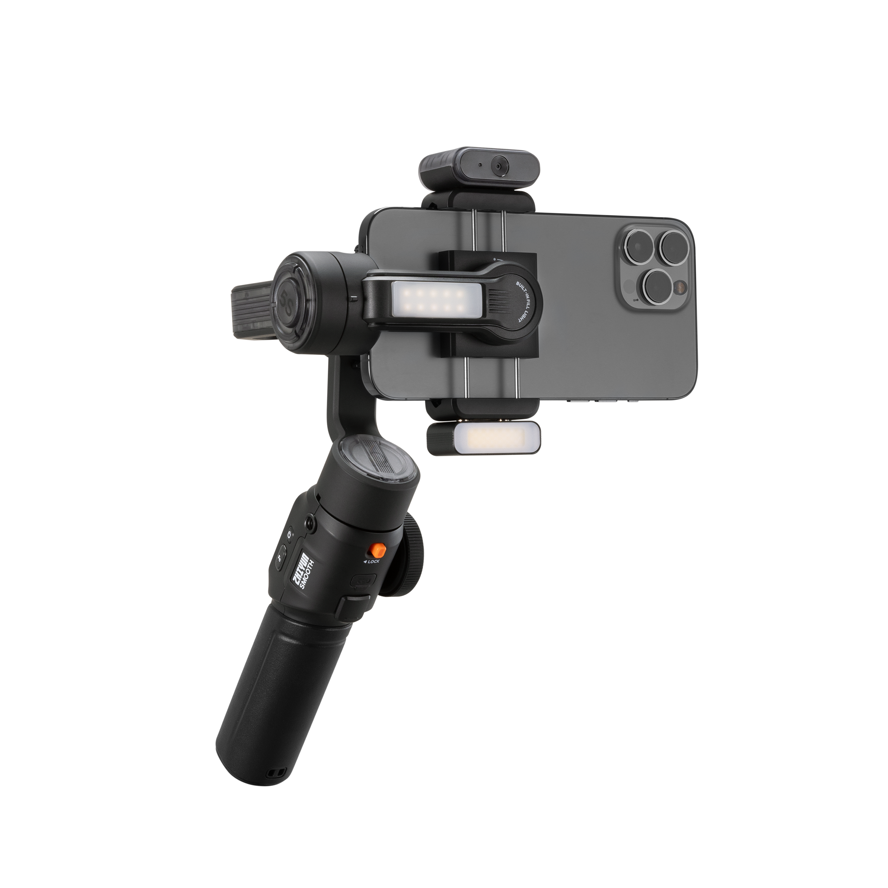
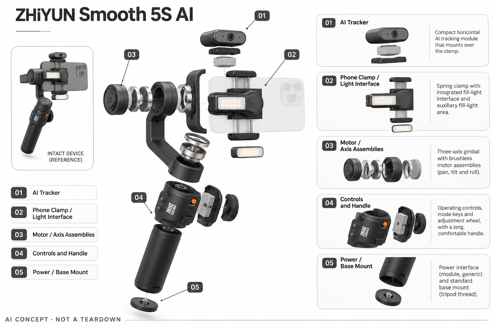

# ZHIYUN Smooth 5S AI

**ZHIYUN 智云** · 智能云台 · 核查 2026-11-04

把磁吸AI追踪模块、手机稳定与补光组合成个人拍摄工具。

消费渠道：个人零售。

## 产品图片与结构参考

### 产品图

ZHIYUN Smooth 5S AI 官方产品图 · 来源：[ZHIYUN 智云](<https://store.zhiyun-tech.com/products/zhiyun-smooth-5s-ai-combo>) · [原始图片](<https://cdn.shopify.com/s/files/1/0049/0101/1502/files/5SAI_a3d725bd-5286-4bf8-b8b5-d2955f32e15a.png?v=1783504812>)

### 参考图

ZHIYUN Smooth 5S AI 官方外观 / 使用参考图 · 来源：[ZHIYUN 智云](<https://store.zhiyun-tech.com/products/zhiyun-smooth-5s-ai-combo>) · [原始图片](<https://cdn.shopify.com/s/files/1/0049/0101/1502/files/5SAI.jpg?v=1719289494>)

### AI 生成爆炸示意

**AI 生成 · 非实物拆机。** 内部为概念推断，不能作为元件布局、BOM 或维修依据。[生成提示词](../../content/hardware/prompts/zhiyun-smooth-5s-ai.txt)

> 分析为基于公开资料的案头研究与 AI 辅助判断，未经用户访谈、销量审计或实物拆机。需求、画像、竞争冷门度、审美及商业机会均为研究假设，不是投资结论。

## 销售与购买

- 状态：在售。官方Combo商品页有加购，公开系列商品数据Combo可售；同页部分预售模板文案与库存显示并存，交期仍按具体结算确认。

- 地区：美国官方店、欧洲官方配送市场

- 价格：Combo约US$153（商品数据促销参考）。为所标地区和配置的核查参考；活动、税费、物流及可选服务以实际结算为准，不进行汇率换算或保证最低价。

- 中国大陆：本轮核查海外官方消费渠道，未验证中国大陆结算、型号、保修与全部AI服务可用性；不因品牌来源或支持中文推定国内可购。

- [官方产品 / 商店](<https://store.zhiyun-tech.com/products/zhiyun-smooth-5s-ai-combo>)

## AI 的实际作用

AI追踪模块识别人脸或拍摄主体并联动三轴云台；不同套装是否包含追踪模块和补光附件必须核对。

服务与联网依赖：主要功能取决于安装的追踪器、手机和App组合。标准、Combo、Pro合并为一款，不把未随附的AI附件写成所有包装标配。

## 是否冷门

竞争密集（研究判断）：手机云台属于竞争密集的消费创作工具，AI附件是体验差异，不意味着冷门蓝海。

## 需求与市场

需求假设：独自拍摄者希望获得稳定画面、自动跟随和可用的补光，而不搭建复杂机位。组合是否更省事取决于真实拍摄环境；只增加硬件部件并不必然减少用户需要操作的步骤。

## 用户画像

画像推断：个人主播、手机视频作者以及经常录制人物内容的用户，愿意为可控画面携带配件。只偶尔随手记录的人可能更看重轻便，不能把手机摄影兴趣直接等同于购买高阶云台。

## 竞争与替代

竞争判断：与Hohem、Insta360、DJI及普通自动追踪支架竞争，价格带和兼容性都很拥挤。差异需要落到独立AI模块、操作手感及补光组合，而不是只强调同类产品普遍具备的防抖。

## 供应链

已公开磁吸追踪与灯光模块、三轴结构和电池类别，具体器件供应链未知。分析关键是夹具兼容、磁吸连接、电机调校、灯光散热和装配一致性，不推定厂商的真实采购合同与BOM。

## 技术路径

技术链路由视觉识别、运动预测和三轴控制组成，追踪不等于相机本身的对焦。独立模块与App模式的兼容边界需要按所买套装确认，本轮没有在不同光照和遮挡下测试表现。

## 产品审美

设计观察：透明或半透明细节与外接模块突出技术工具感，补光也改变了握持重量。收纳、装配和竖屏转向是否自然，是比单张官方渲染图更值得观察的消费体验。

## 关键风险

风险在于套餐复杂、同页促销与交期模板混杂，以及购买后发现缺少AI模块。兼容的手机尺寸和操作系统需要核对；没有现场测试时不能接受所有极限续航和追踪承诺为事实。

## 机会与验证

可验证的市场空间是稳定加追踪加灯光能否形成低摩擦的单人拍摄流程。建议比较同一任务中的装配时间和补拍次数，本轮未进行成片率测试或推断品牌市场占有率。

## 功能分层示意

这是功能关系，不是实物拆机、真实空间结构或已核实 BOM。

1. **视觉输入**：AI跟踪模块或应用视觉输入识别目标。（官方披露）

2. **跟踪计算**：将目标位置转换为构图和运动决策。（官方披露）

3. **三轴执行**：电机和关节保持拍摄方向，实际表现需测试。（官方披露）

4. **控制与连接**：屏幕、按键或App提供个人操作入口。（官方披露）

5. **电池与结构**：供电、夹具与配重影响持续拍摄。（分析推断）

## 来源

1. [Smooth 5S AI Combo 官方店](<https://store.zhiyun-tech.com/products/zhiyun-smooth-5s-ai-combo>) — 按含AI模块的Combo理解功能，不另计套装。

2. [Smooth 5S AI 官方商品数据](<https://store.zhiyun-tech.com/products/zhiyun-smooth-5s-ai.js>) — 核查时Combo available=true，价格以当前地区结算为准。

[返回目录](../hardware-market.md) · [网页分析](https://romanagent.github.io/Roman/#hardware/product/zhiyun-smooth-5s-ai)
