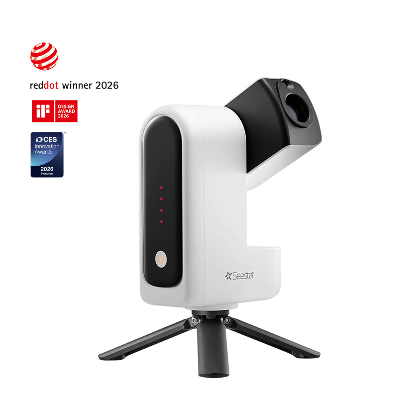
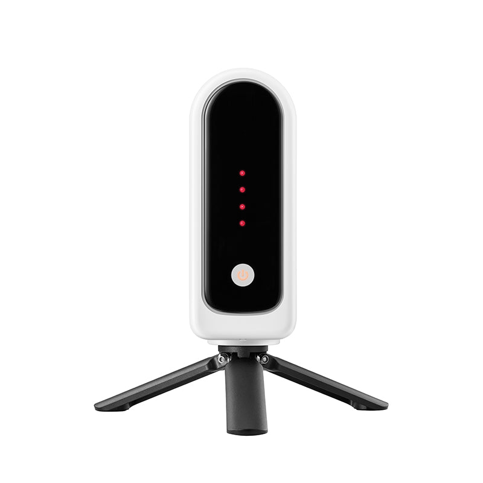
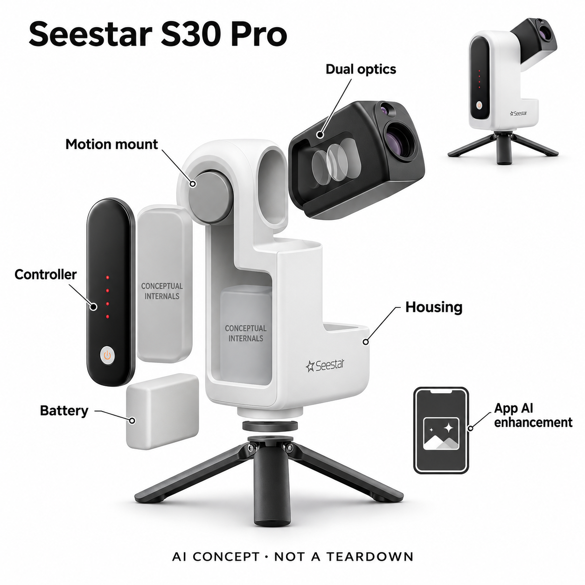

# ZWO Seestar S30 Pro

**ZWO Seestar** · 天文观测 · 核查 2026-11-05

把天文采集和App AI图像增强连起来的便携观测设备

消费渠道：个人零售。

## 产品图片与结构参考

### 产品图

ZWO Seestar S30 Pro 官方产品图 · 来源：[ZWO Seestar · 官方资料](<https://us.seestar.com/products/seestar-s30-pro>) · [原始图片](<https://cdn.shopify.com/s/files/1/0756/5728/1827/files/s30_pro_main.jpg?v=1776933982&width=1600>)

### 参考图

ZWO Seestar S30 Pro 官方外观与使用参考图 · 来源：[ZWO Seestar · 官方资料](<https://us.seestar.com/products/seestar-s30-pro>) · [原始图片](<https://cdn.shopify.com/s/files/1/0756/5728/1827/files/S30Pro-4.jpg?v=1772516860&width=1600>)

### AI 生成爆炸示意

**AI 生成 · 非实物拆机。** 内部为概念推断，不能作为元件布局、BOM 或维修依据。[生成提示词](../../content/hardware/prompts/zwo-seestar-s30-pro.txt)

> 以官方外观图为参照，已目视核对型号、外形、未提供参数与非拆机标记；内部位置仅为功能概念。

> 图片保留官方原貌；其中的宣传数字和效果不作为本站实测结论。

> 2026-11-05修正产品来源入口为美国官方站，避免www地域跳转404；原图URL与11月4日图像核验日期保留。

> 分析为基于公开资料的案头研究与 AI 辅助判断，未经用户访谈、销量审计或实物拆机。需求、画像、竞争冷门度、审美及商业机会均为研究假设，不是投资结论。

## 销售与购买

- 状态：在售。2026-11-05实际浏览美国官方站S30 Pro显示US$699、In stock - Ready to be shipped和Add to cart；原www入口在当前地区跳转中国站同路径404，属于地域路由问题而非停售。中国官网官方天猫入口与型号比较沿用11月4日核查。

- 地区：中国大陆、美国、欧洲、全球站支持地区

- 价格：美国官网US$699；国内渠道价格为准。核查日官方价格；不沿用早期US$599信息，税运费与地区版本另核。

- 中国大陆：Seestar中国官网列S30 Pro官方天猫入口。大陆与海外版本有激活地域差异；大陆版官方限定大陆、香港、澳门激活使用。

- [官方产品 / 商店](<https://us.seestar.com/products/seestar-s30-pro>)

## AI 的实际作用

官方手册与教程明确Seestar App提供AI Denoise / AI Enhance，对望远镜拍摄的叠加图像作降噪等增强；当前产品页另列AI助手。普通自动寻星、跟踪和拼接不作为AI判定依据。

服务与联网依赖：图像AI功能依赖Seestar App；官方教程允许下载素材后离线处理，移动设备性能会影响完成率。语音助手的模型、联网范围未充分披露。

## 是否冷门

细分专业（研究判断）：天文爱好者是明确但有限的兴趣场景；专业操作障碍可降低，天气和观测频次仍限制家庭留存。

## 需求与市场

案头需求是把深空题材从复杂器材组合变成能随身带走的采集流程，并降低初次后期门槛。AI作用主要在已拍影像处理，不能消除天气、遮挡和光污染，也不能代替观测时间。

### 事实：任务边界 · 官方资料

S30 Pro把长焦与广角采集、指向转台、调焦和控制放进便携机身，通过App完成目标选择及后期处理。官方手册明确展示AI降噪入口，当前教程又提供AI增强工作流，因此本条研究的是从自己采集星空到可分享影像的完整任务，而非普通自动寻星。

依据：[Seestar S30 Pro美国官方商店](<https://us.seestar.com/products/seestar-s30-pro>) · [Seestar S30 Pro用户手册](<https://cdn.shopify.com/s/files/1/0756/5728/1827/files/Seestar_S30_Pro_User_Manual.pdf?v=1768828988>) · [Seestar AI Enhance官方教程](<https://us.seestar.com/blogs/seestar-guide/seestar-ai-enhance>)

### 判断：真实需求 · 研究判断

需求判断要区分想观看天空、想拍出自己的照片和想做精密观测的人。对初学者，一体化可能减少器材接线和后期学习成本；但它不会让被云遮住的天空出现细节，若用户缺少合适观测地点，购买更简单的设备也未必带来经常使用。

依据：[Seestar S30 Pro美国官方商店](<https://us.seestar.com/products/seestar-s30-pro>) · [Seestar S30 Pro用户手册](<https://cdn.shopify.com/s/files/1/0756/5728/1827/files/Seestar_S30_Pro_User_Manual.pdf?v=1768828988>) · [Seestar AI Enhance官方教程](<https://us.seestar.com/blogs/seestar-guide/seestar-ai-enhance>)

### 验证：任务完成 · 待验证

可让初学者从收纳状态开始，完成选址、架设、找到目标、得到一张原始图与一张增强图，记录每一步等待和求助。访谈问他们愿意等多久、是否理解图像来自自己拍摄，以及天气不合适时会延期再试还是放弃这一兴趣。

依据：[Seestar S30 Pro美国官方商店](<https://us.seestar.com/products/seestar-s30-pro>) · [Seestar S30 Pro用户手册](<https://cdn.shopify.com/s/files/1/0756/5728/1827/files/Seestar_S30_Pro_User_Manual.pdf?v=1768828988>) · [Seestar AI Enhance官方教程](<https://us.seestar.com/blogs/seestar-guide/seestar-ai-enhance>)

## 用户画像

适合想拍到自己获取的星云或银河画面、愿意使用手机App的入门爱好者和家庭观测者。追求目镜直视或严谨科学测光的人需求不同，不应因为同属天文兴趣就默认这台一体机适配。

### 事实：使用条件 · 官方资料

产品以手机或平板App作为主要控制界面，图像增强教程提醒移动设备性能会影响处理成功，官方也要求未成年人在成人监督下使用。它没有传统目镜式观测的使用流程；用户需要接受屏幕观看、设备连接和数据管理这些前提。

依据：[Seestar S30 Pro用户手册](<https://cdn.shopify.com/s/files/1/0756/5728/1827/files/Seestar_S30_Pro_User_Manual.pdf?v=1768828988>) · [Seestar AI Enhance官方教程](<https://us.seestar.com/blogs/seestar-guide/seestar-ai-enhance>)

### 判断：人群筛选 · 研究判断

可优先研究有固定露台、可达观测地或参加天文活动的初学爱好者，以及愿意陪同孩子观测的家长。把所有喜欢星空的人都当目标会夸大需求，因为有人更看重肉眼现场感，有人只想浏览成片，而另一些人追求可校验的科研数据。

依据：[Seestar S30 Pro用户手册](<https://cdn.shopify.com/s/files/1/0756/5728/1827/files/Seestar_S30_Pro_User_Manual.pdf?v=1768828988>) · [Seestar AI Enhance官方教程](<https://us.seestar.com/blogs/seestar-guide/seestar-ai-enhance>)

### 验证：参与者差异 · 待验证

参与者分组应记录可用观测时间、地点遮挡、手机型号和以往拍摄经验。让他们解释增强图与原图的关系，询问是否愿意在寒冷或等待中再次操作；这些问题能把兴趣表达与实际使用条件区分，而不是用自报热情直接推断购买。

依据：[Seestar S30 Pro用户手册](<https://cdn.shopify.com/s/files/1/0756/5728/1827/files/Seestar_S30_Pro_User_Manual.pdf?v=1768828988>) · [Seestar AI Enhance官方教程](<https://us.seestar.com/blogs/seestar-guide/seestar-ai-enhance>)

## 竞争与替代

竞争包括其他智能望远镜、传统相机加赤道仪及电脑后期软件。本轮只保留一个小型天文成像代表，避免按口径与传感器升级堆型号；比较重点是架设、采集和处理的总时间。

### 事实：方案范围 · 官方资料

官方比较页列出多个Seestar型号在售或下架状态，本轮仅保留S30 Pro一个便携成像代表，没有按口径、传感器或版本更替堆叠条目。传统相机与赤道仪、其他一体望远镜和电脑天文处理软件，仍然提供与它部分相同的任务能力。

依据：[Seestar S30 Pro美国官方商店](<https://us.seestar.com/products/seestar-s30-pro>) · [Seestar在售型号比较](<https://helpdesk.zwoastro.com/hc/en-us/articles/48476700259213-Seestar-S30-S50-S50-Pro-S30-Pro-Comparison>)

### 判断：替代关系 · 研究判断

一体机的优势假设是减少搭建和调参，但也把升级选择、维修和控制体验集中在单一系统。与手机直接拍夜空相比，专用光学和跟踪提供不同采集条件；与完整天文器材相比，便携流程可能更轻便，但不能据此断言画质或科学用途全面占优。

依据：[Seestar S30 Pro美国官方商店](<https://us.seestar.com/products/seestar-s30-pro>) · [Seestar在售型号比较](<https://helpdesk.zwoastro.com/hc/en-us/articles/48476700259213-Seestar-S30-S50-S50-Pro-S30-Pro-Comparison>)

### 验证：比较方法 · 待验证

比较应给不同方案同样的目标、天空条件与准备时间，分别展示原始采集、默认处理和人工后期结果。让用户评价所需学习投入和愿意反复完成的步骤，避免只比较厂家精修样片，也不把算法增强后的清晰观感当成原始分辨信息。

依据：[Seestar S30 Pro美国官方商店](<https://us.seestar.com/products/seestar-s30-pro>) · [Seestar在售型号比较](<https://helpdesk.zwoastro.com/hc/en-us/articles/48476700259213-Seestar-S30-S50-S50-Pro-S30-Pro-Comparison>)

## 供应链

公开模块包含长焦与广角光学、图像传感器、转台、控制、电池与App。官网点名Sony传感器但未披露完整代工链；镜头装调、转轴精度与户外温差下的成像一致性需要共同验证。

### 事实：功能组成 · 官方资料

官方规格点名长焦与广角采用Sony图像传感器，并公开光学、滤镜、转台、电池及控制的功能组成；这构成有限的公开采用证据。镜头装调厂、转台驱动供应商和整机代工仍未披露，不能由品牌所在地或传感器名称推出其余制造链。

依据：[Seestar S30 Pro美国官方商店](<https://us.seestar.com/products/seestar-s30-pro>) · [Seestar S30 Pro用户手册](<https://cdn.shopify.com/s/files/1/0756/5728/1827/files/Seestar_S30_Pro_User_Manual.pdf?v=1768828988>)

### 判断：交付约束 · 研究判断

成像系统需要光学轴线、传感器位置和运动控制共同保持一致，户外温差、运输冲击和结露也会影响结果。供应判断应同时关注出厂标定、装配后星点形态与售后校准，而不是只采购一颗与官网同型号的传感器就认为可复制整机。

依据：[Seestar S30 Pro美国官方商店](<https://us.seestar.com/products/seestar-s30-pro>) · [Seestar S30 Pro用户手册](<https://cdn.shopify.com/s/files/1/0756/5728/1827/files/Seestar_S30_Pro_User_Manual.pdf?v=1768828988>)

### 验证：选型缺口 · 待验证

Sony关联仅覆盖官网明确点名的图像传感器，不延伸到算法或主控；FAULHABER可作为精密驱动能力候选，但需核验转台负载、回差、噪声和控制接口。对未披露模块只建立询样问题，不推算工厂、BOM价格、良率或量产交期。

依据：[Seestar S30 Pro美国官方商店](<https://us.seestar.com/products/seestar-s30-pro>) · [Seestar S30 Pro用户手册](<https://cdn.shopify.com/s/files/1/0756/5728/1827/files/Seestar_S30_Pro_User_Manual.pdf?v=1768828988>)

## 技术路径

AI图像处理在官方App工作流中有明确入口，教程还说明移动设备性能不足时可降低处理分辨率。自动寻星是另一条控制能力，不混称为AI；本机与App的计算边界要向用户讲清楚。

### 事实：AI机制 · 官方资料

官方教程将AI增强放在Seestar App的后期流程中，允许先下载拍摄文件再离线处理，且建议低性能移动设备降低处理负担。手册的AI Denoise与当前AI Enhance均针对已采集图像；普通目标寻星、跟踪与规划控制不被当作AI证据。

依据：[Seestar S30 Pro美国官方商店](<https://us.seestar.com/products/seestar-s30-pro>) · [Seestar S30 Pro用户手册](<https://cdn.shopify.com/s/files/1/0756/5728/1827/files/Seestar_S30_Pro_User_Manual.pdf?v=1768828988>) · [Seestar AI Enhance官方教程](<https://us.seestar.com/blogs/seestar-guide/seestar-ai-enhance>)

### 判断：系统边界 · 研究判断

这意味着系统价值来自专用采集与软件处理相连，而不能说全部AI都在望远镜主控上运行。当前产品页还有语音AI助手，但公开材料未充分说明其模型、联网条件和各地区语言覆盖，因此主要分析依据仍是已具备清晰操作路径的图像增强。

依据：[Seestar S30 Pro美国官方商店](<https://us.seestar.com/products/seestar-s30-pro>) · [Seestar S30 Pro用户手册](<https://cdn.shopify.com/s/files/1/0756/5728/1827/files/Seestar_S30_Pro_User_Manual.pdf?v=1768828988>) · [Seestar AI Enhance官方教程](<https://us.seestar.com/blogs/seestar-guide/seestar-ai-enhance>)

### 验证：算法与体验 · 待验证

验证可保留相同素材的原图、默认增强和用户调整结果，检查弱细节、星点和背景是否出现难以解释的变化，并记录处理时间及失败情况。手机断网或与望远镜断开后的行为也应实测，以区分已下载后期能力与首次连接、激活需求。

依据：[Seestar S30 Pro美国官方商店](<https://us.seestar.com/products/seestar-s30-pro>) · [Seestar S30 Pro用户手册](<https://cdn.shopify.com/s/files/1/0756/5728/1827/files/Seestar_S30_Pro_User_Manual.pdf?v=1768828988>) · [Seestar AI Enhance官方教程](<https://us.seestar.com/blogs/seestar-guide/seestar-ai-enhance>)

## 产品审美

白色折叠机身和短三脚架比传统长镜筒更便携，结构上让光学臂的转动可见。分析上，夜间指示灯、手套操作、镜头保护和收纳仍需实测，外形简洁并不等于无需维护。

### 事实：外观与交互 · 官方资料

真实产品图显示白色立式机身、黑色旋转光学臂以及短三脚架，收拢状态与展开拍摄状态的轮廓不同。机身没有传统长镜筒的视觉负担；此次参考图保留按钮和指示灯位置，生成的分层图明确是功能概念，不展示未经证实的内部板件。

依据：[Seestar S30 Pro美国官方商店](<https://us.seestar.com/products/seestar-s30-pro>) · [Seestar S30 Pro用户手册](<https://cdn.shopify.com/s/files/1/0756/5728/1827/files/Seestar_S30_Pro_User_Manual.pdf?v=1768828988>)

### 判断：使用中的形态 · 研究判断

紧凑外形可能帮助使用者把设备带去旅行，但便携审美也要包括夜间辨识和保护镜头的方式。大面积白壳便于看见装置，状态灯是否影响暗环境、用手套能否操作、打包时光学臂是否稳定，都是照片无法回答的具体体验问题。

依据：[Seestar S30 Pro美国官方商店](<https://us.seestar.com/products/seestar-s30-pro>) · [Seestar S30 Pro用户手册](<https://cdn.shopify.com/s/files/1/0756/5728/1827/files/Seestar_S30_Pro_User_Manual.pdf?v=1768828988>)

### 验证：日常接受度 · 待验证

可以在实际收纳包和弱光场景下观察用户独立架设，记录找到电源、调整位置和收起光学臂的错误动作。让用户描述哪一处像可抓握把手、哪一处担心受力，并对镜头清洁与保护说明做理解测试，避免以小巧等同于耐摔免维护。

依据：[Seestar S30 Pro美国官方商店](<https://us.seestar.com/products/seestar-s30-pro>) · [Seestar S30 Pro用户手册](<https://cdn.shopify.com/s/files/1/0756/5728/1827/files/Seestar_S30_Pro_User_Manual.pdf?v=1768828988>)

## 关键风险

风险集中在地域激活误购、处理结果与原始数据混用，以及把天气条件和厂家样片当作保证。太阳观测须遵循官方滤镜说明；AI后期应保存原图，便于区分采集信息与增强效果。

### 事实：已知限制 · 官方资料

商店明确区分大陆与海外版本，大陆版仅支持在大陆、香港及澳门激活使用；官方还提示天气、光污染和拍摄时长影响成像。太阳观测必须按官方指南安装合适滤镜，因此不能把一般夜间操作流程直接延伸到观看太阳的任务。

依据：[Seestar S30 Pro美国官方商店](<https://us.seestar.com/products/seestar-s30-pro>) · [Seestar S30 Pro用户手册](<https://cdn.shopify.com/s/files/1/0756/5728/1827/files/Seestar_S30_Pro_User_Manual.pdf?v=1768828988>) · [Seestar中国官网](<https://www.seestar.cn/>)

### 判断：失效影响 · 研究判断

主要信息风险是用户把处理后图片当成未经变化的原始观测，或者被宣传样片引导，预期城市阳台也能得到同样效果。地域版本误购则可能在激活或保修阶段暴露；这些问题比简单罗列像素数更直接影响买到后能否完成目标。

依据：[Seestar S30 Pro美国官方商店](<https://us.seestar.com/products/seestar-s30-pro>) · [Seestar S30 Pro用户手册](<https://cdn.shopify.com/s/files/1/0756/5728/1827/files/Seestar_S30_Pro_User_Manual.pdf?v=1768828988>) · [Seestar中国官网](<https://www.seestar.cn/>)

### 验证：风险处理 · 待验证

购买核对可先确认激活地区、设备与App版本、原始文件导出及售后政策；观测测试则记录真实天空条件并同时保存原图。若计划定时拍摄，还应观察天气变化后的中止方式和设备保护，不用一次成功样片掩盖失败场次。

依据：[Seestar S30 Pro美国官方商店](<https://us.seestar.com/products/seestar-s30-pro>) · [Seestar S30 Pro用户手册](<https://cdn.shopify.com/s/files/1/0756/5728/1827/files/Seestar_S30_Pro_User_Manual.pdf?v=1768828988>) · [Seestar中国官网](<https://www.seestar.cn/>)

## 机会与验证

机会假设是观测活动与简单后期教学，而非再增加一个同规格望远镜。可招募初学者完成首次架设、选目标、导出原图和增强对照，统计失败步骤及隔月是否再次观测。

### 判断：可尝试切口 · 研究判断

一个可验证切口是围绕首次观测提供活动、场地和后期理解指引，而不是再次推出同核心任务、略改口径的机器。对没有入门经验的人，学会选择天气、理解等待和区分原图增强图，可能比增加自动按钮更能提高第二次使用概率。

依据：[Seestar S30 Pro美国官方商店](<https://us.seestar.com/products/seestar-s30-pro>) · [Seestar AI Enhance官方教程](<https://us.seestar.com/blogs/seestar-guide/seestar-ai-enhance>)

### 判断：商业边界 · 研究判断

商业边界在于兴趣频次与环境条件。家庭偶尔展示星空和持续天文摄影所需的服务不同，前者未必愿意为复杂课程付费，后者可能逐步迁移至可扩展系统；本轮没有俱乐部访谈或销量数据，不把小众兴趣直接等同于高付费意愿。

依据：[Seestar S30 Pro美国官方商店](<https://us.seestar.com/products/seestar-s30-pro>) · [Seestar AI Enhance官方教程](<https://us.seestar.com/blogs/seestar-guide/seestar-ai-enhance>)

### 验证：下一步调研 · 待验证

下一步可跟踪一次入门活动和随后一个月的自主使用，记录重新架设次数、失败原因、分享对象与后期求助。询问如果没有自动增强还会不会继续拍摄，并用真实复用行为决定是否深入研究，不用自动打分推断这一品类的增长规模。

依据：[Seestar S30 Pro美国官方商店](<https://us.seestar.com/products/seestar-s30-pro>) · [Seestar AI Enhance官方教程](<https://us.seestar.com/blogs/seestar-guide/seestar-ai-enhance>)

## 对应供应链公司

能力候选用于选型研究，不代表本产品实际采用；未公开的供货关系不作推断。

- [sony-semiconductor-solutions](../supply-chain/sony-semiconductor-solutions.md) — **公开披露关系** / 长焦及广角图像传感器：Seestar官方规格明确将长焦IMX585与广角IMX586标为Sony图像传感器，可据此建立有限公开采用关联。该证据仅覆盖传感器身份，不证明Sony提供整机主控、图像算法、相机模组或直接供货商务关系。

- [faulhaber](../supply-chain/faulhaber.md) — **能力候选 · 非已采用** / 光学转台精密驱动候选：产品需要运动转台与光学指向配合，FAULHABER公开有光学设备驱动及定制电机能力。它只是可评估的功能候选，转矩、回差、噪声、控制接口和户外工况尚须验证，未找到Seestar使用其驱动的公开点名证据。

[浏览供应链目录](../supply-chain.md)

## 功能分层示意

这是功能关系，不是实物拆机、真实空间结构或已核实 BOM。

1. **双光学采集**：长焦与广角光学及图像传感器获取天空图像。（官方披露）

2. **机械指向**：一体化转台、调焦与跟踪维持拍摄，普通自动控制不等于AI。（官方披露）

3. **控制与连接**：本机控制和无线连接配合Seestar App。（官方披露）

4. **图像处理**：App的AI Denoise / AI Enhance处理下载或叠加图像，可保留前后对照。（官方披露）

5. **电源与机身**：内置电池、折叠光学臂、机壳与三脚架构成便携系统。（官方披露）

## 来源

1. [Seestar S30 Pro美国官方商店](<https://us.seestar.com/products/seestar-s30-pro>) — 2026-11-05实际浏览美国官方入口，699美元、现货与加购可用；原www入口对当前地区误跳.cn同路径404，不据此判断停售。

2. [Seestar S30 Pro用户手册](<https://cdn.shopify.com/s/files/1/0756/5728/1827/files/Seestar_S30_Pro_User_Manual.pdf?v=1768828988>) — 实际打开34页官方PDF；机身结构及深空示例中的AI Denoise入口。

3. [Seestar AI Enhance官方教程](<https://us.seestar.com/blogs/seestar-guide/seestar-ai-enhance>) — 2026-11-05实际浏览美国官方教程；App增强、BIN2性能限制和下载后离线处理保持可核。原www地域路由会落到.cn无对应路径。

4. [Seestar中国官网](<https://www.seestar.cn/>) — 实际打开；S30 Pro官方天猫入口，未断言国内结算价格。

5. [Seestar在售型号比较](<https://helpdesk.zwoastro.com/hc/en-us/articles/48476700259213-Seestar-S30-S50-S50-Pro-S30-Pro-Comparison>) — 实际打开；2026年9月更新列S30 Pro在售，旧S30/S50下架。

[返回目录](../hardware-market.md) · [网页分析](https://romanagent.github.io/Roman/#hardware/product/zwo-seestar-s30-pro)
